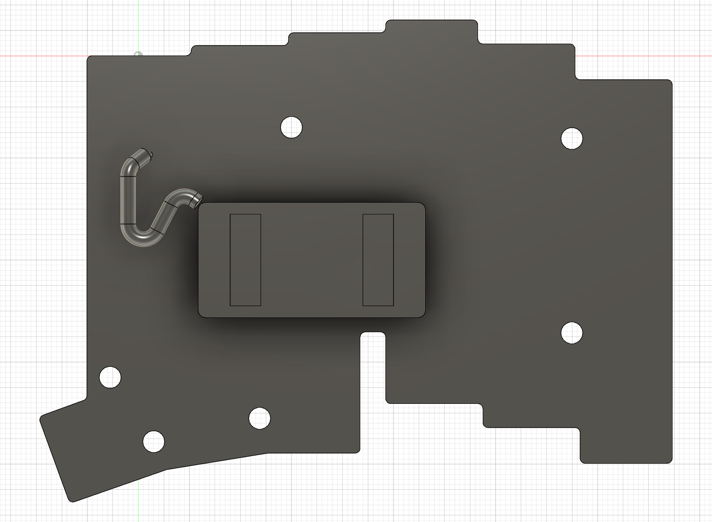

# 40 mm直付け線の余長ループと整備姿勢（v25）

更新: 2026-11-08のv25記録。最新は[ケース固定の配線保持部（v26）](case-mounted-wire-restraint.md)。v25は保存・処理完了・未保存変更なしで終了した。v24の短い接続経路に対して残っていた約21.42 mmの線の収納を検討した。**40 mm全長を使う公称曲線と、底を下げた独立姿勢を追加したが、連続した開閉・引張り止め・実線の適合は未認定。**

## 追加した形状

各線の全長を40 mmと仮定し、束中心線にR3の3D円弧を使うU字ループを作成。D3は2本束の保守的な比較包絡、端部はD1の分岐である。個々の線の径・相対位置・長さ公差を再現していない。写真の銀色はCAD表示で、実線の材質や被覆を示さない。

| 長さの内訳 | mm |
| --- | ---: |
| パウチ出口からCAD開始点までの仮遷移 | 1.876166 |
| 円弧と直線による束中心線 | 35.821058 |
| 各パッドへの分岐＋最後のはんだ位置までの仮0.5 | 2.302776 |
| 各線の公称合計 | 40.000000 |

以前の18.58 mmは短い接続経路の比較値として `RETIRED_MINIMUM_PATH_…` に退避。旧JST経由31.08 mmも履歴のまま保持した。現行の `BATTERY_WIRE_ROUTE_D3_DIRECT_SOLDER_B1_40mm_R3_LOOP_NOT_PART` が閉じた状態の比較包絡である。

底ケースと電池一式を2／5／8／10 mm下げたときについても、それぞれ全長40 mm・仮R3を保つ中心線を別々に計算し、`BATTERY_SERVICE_POSES_R3_LENGTH40_CENTERLINES_NOT_PARTS` に非表示で保存。線は実物では固定長だが、曲線同士を連続して変形できること、摩擦・ねじれ・引張りを生じないことまでは解いていない。

R4／R5も同じ制御点族で探索したが、閉じた姿勢の40 mm解は得られなかった。R4以上がケース全体で不可能という意味ではない。実線の最小曲げ半径がR3を許容しなければ、別の経路族で再検討する。

R3は束の円弧部分に限った仮定で、パウチ出口の遷移やD1端部分岐まで最小半径3 mmを満たすとは扱わない。端部の曲げ・はんだ周辺は個々の実線と固定方法に合わせて再設計する。

## 検査した範囲

まずFusionの一時ワイヤボディを直線／3D円弧から作成し、CADカーネルの辺長と計算長を照合。各姿勢で移動対象は下ケース・電池・受け・仮粘着層、固定対象は上ケース・カバー・PCB・支持絶縁・詳細XIAO・23組のChocである。

物体同士の全移動ブーリアン検査は行わず、対象をBBox距離で絞り、中心線から立体までの最短距離と内外判定を使った。D3の球状オフセットに必要な半径1.5 mmを差し引き、各姿勢16〜18件の距離検査で負の空隙はなかった。各姿勢の最小名目余裕はパウチ出口側の仮開始点対電池で約0.197 mm。パウチ出口の最初の1.876 mmと最後のはんだ形状はこの検査の対象外で、公差を含む安全な隙間とは扱わない。

| 底の下降量 mm | 個別姿勢の線長 mm | 距離問い合わせ数 | D3比較包絡の必要空間 |
| ---: | ---: | ---: | --- |
| 0 | 40 | 18 | 指定対象で確保 |
| 2 | 40 | 18 | 指定対象で確保 |
| 5 | 40 | 16 | 指定対象で確保 |
| 8 | 40 | 17 | 指定対象で確保 |
| 10 | 40 | 16 | 指定対象で確保 |

閉じた配線は履歴付きPipeでモデル化し、61主要ソリッドと新配線、詳細ソケット、既存の確認用空間の静的検査も実施。古い10×10×4 mm余長予約とループの交差約61.50 mm³は、確認用空間同士の意図した重なりとして区別した。

これは線の姿勢に対する空間検査で、下ケース自体が途中で支持・位置決め・PCB等へ引っ掛からずに動くことや、カバー／PCBの取り出しを認定したものではない。

## 引張り止めと整備手順

基板下面に、X−4.38934〜1.61066、Y−24〜−22、Z−0.2〜0 mmの6×2×0.2の接着候補面を予約した。基板輪郭の4隅＋中央が内側にあること、下ケースまで5.8 mm・上ケースまで2.6 mmの空間、公開B1信号パッドとの平面距離0.909 mmを確認。

**この薄い予約面だけでは線を保持できない。v26ではケース固定案を採用し、このPCB接着面は退避した。** 固定具・支持アーム・被覆を傷めない保持形状は未実装である。実機の銅箔・ビア・ソルダーレジスト・周辺部品、接着材の適合と剥離作業を確認してから採否を決める。線をPCBへ固定する場合は、パッドより手前の被覆部分を支え、ループ側の動きがはんだへ伝わらない設計が必要となる。

整備の候補手順は以下。実物検証前の手順案であり、10 mmの開口を承認値としない。

1. ケースを支持して底の4ねじを外し、PCB・スイッチ側が落ちないよう別に支持する。
2. 底を小さく下げ、線とループを目視する。40 mmの線で底を吊らない。
3. 電池受けを底へ留める仮の剥離可能な固定層を解放し、電池一式をPCB側と一緒に支持する。底だけを大きく離す前に線のつながりを解消する構成を検討する。
4. 閉じるときはループを内側へ収め、合わせ面・支持・ねじ軸に掛からないことを確認して仮締めする。

直付け電池の交換には、はんだ接続の再作業が伴う。線の外径・被覆・実際の出口方向と最小曲げ半径、固定材、受けの取り外し操作が次の確認事項。スタンドの実ヒンジ軸・開閉軌跡と接地安定性も未確認で、右ケースへ進む前に残条件を分けて整理する。

## 保存と再実行

変更前v24は `cad/design/checkpoints/v05_cloud_v24_before_battery_service_loop.f3d` に退避。現行全体F3D・主JSON・承認済み構成・本引き継ぎを更新。ケースと電池受け、PCB・Choc等の旧体積・変換を保持し、上ケースSTEP v22／下ケースSTEP v20は更新しない。新しい線・姿勢・接着面はすべて検討参照で、加工部品STEPへは含めない。

電池は実体4個＋確認用10個。23スイッチ・23ソケット、23ステム上端、pin3不在、タイムライン警告0を再確認した。表示は撮影前に復元。ソース参照は変更していない。

`add-battery-service-loop.py` と `finalize-battery-service-loop.py` はv24専用の一回限り処理。現行へ再実行しない。Pipeパスには入れ子コンポーネントの組立コンテキストを渡す必要があった。失敗した試行はAPIトランザクションでロールバックされ、元の承認済み構成を照合してから修正を適用した。

[計算](battery-service-loop-study.json)、[閉状態の検査](battery-service-loop-verification-gap0.json)、[2 mm](battery-service-loop-verification-gap2.json)、[5 mm](battery-service-loop-verification-gap5.json)、[8 mm](battery-service-loop-verification-gap8.json)、[10 mm](battery-service-loop-verification-gap10.json)、[接着候補面](battery-strain-relief-site-verification.json)、[変更記録](battery-service-loop-development.json)、[最終確認](battery-service-loop-final-verification.json)。
