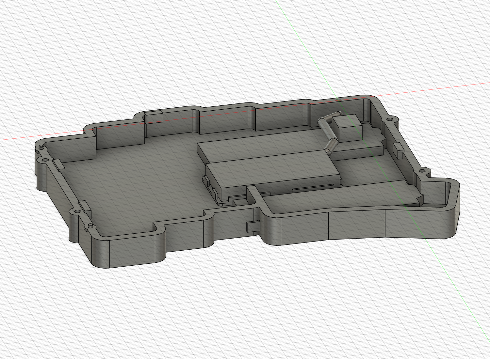

# 42×20×5 mm電池・配線40 mmの配置候補

更新: 2026-11-08。現行クラウドv17、処理完了。ケース本体・スタンド収納・MCUカバーの形状はv15から変更なし。元参照データも未変更。未コミット。実物適合・材料・粘着材の保持性能は未検証です。

| 項目 | 現行候補 |
| --- | --- |
| 電池本体の設計対象 | 42×20×5 mm |
| 電池の配置 | X−55〜−13、Y−50〜−30、Z−8.1〜−3.1 mm |
| 電池受けの内寸 | 43×21 mm（各側0.5 mmの名目逃げ） |
| 電池受けの外寸 | 44.6×22.6 mm、底厚1 mm、壁厚0.8 mm・高さ2 mm |
| 仮の設置空間 | 43×21×5.5 mm（上方0.5 mmを含む） |
| 粘着層の予約 | ケース〜受け0.2 mm、受け〜電池0.2 mm |
| 配線長の条件 | 40 mm |
| 仮出口 | コネクタ寄りの角(X−13,Y−30,Z−5.6)、未確定 |
| 配線経路 | 約29.21 mm＋角からの接続約1.88 mm＝約31.08 mm |
| 配線長との差 | 約8.92 mm。成立確認済みの整備ループや曲げ余裕を意味しない |

従来の30×20×4 mm電池受けを拡大し、電池の角がB1接続側へ近づく位置へ移しました。四隅と各辺中央に開放部を設けた非金属の低いガイドで、パウチを上下から締め付ける形状にはしていません。旧配置7個と初回配線候補1個は、非表示の `RETIRED_BATTERY_LAYOUTS_NOT_CURRENT` に保持。古い32×22×5.5 mm電池包絡は非表示の比較データとして元の場所へ残しています。

主要62ソリッド、詳細ソケット、D3配線包絡、仮プラグ作業空間、粘着タブ用空間の干渉は0件。43×21×5.5 mm設置空間、および仮の角から配線開始点へ至るD3接続区間も、ケース・PCB・ソケット・電池受け・B1予約との干渉0件を確認しました。角の接続区間は電池端子側に触れるため、電池本体との重なりは端子接続位置の仮定として除外。CHOC46個の基準位置、USB・キーキャップ包絡、タイムライン警告なし、ケース3部品の体積維持も確認。

42×20×5 mmを本体寸法として扱っています。パウチ封止部・保護回路・端子・使用時の最大外形を含む保証寸法ではありません。43×21×5.5 mmの逃げも認証された膨張余裕ではなく、仮の設計空間です。配線長の測定端点・出口の角・コネクタ端・曲げ半径が未確定のため、40 mm線の実物組み付けを保証する段階ではありません。旧案の15 mm整備余長を追加で要求しておらず、実測線長との比較を約8.9 mmの差として記録します。

## ブラウザの一括表示

クラウドv17で完了。`BATTERY_ASSEMBLY_CELL42_WIRE40_PROVISIONAL` の下に電池・受け・粘着層の4コンポーネント、`CLEARANCE_STUDIES_NOT_PARTS` の下に配線や仮作業空間など6コンポーネントを整理しました。電池実体候補はON、空間確認用の小グループはOFF。旧比較用は `OLD_NOT_CURRENT` に非表示で保持。603件の元構成記録の座標・向き・ボディ数・体積を照合し一致、削除0件。前回の再試行確認待ちは解消しました。

詳細: [階層と表示](component-organization.md)、[配置と検証JSON](battery42-layout-development.json)、[関連干渉検査](internal-retention-fit-verification.json)。全体F3Dを更新済み。電池受けSTEPは形状不変の単一ソリッド出力を維持しています。未コミット。

次は40 mm線の出口・曲げ方・抜き差しの作業性と、ケースを閉める際の挟み込みを確認します。

2026-11-08追加監査: [M2穴の部分閉塞とスタンド裏当ての外周張り出し](v17-fastening-and-overhang-audit.md)を新たに確認。未修正の設計・検証漏れ。従来の指定部品間の体積重複0件は、穴の連続性や外形逸脱まで保証しない。次の機能追加前に修正する。クラウド形状はv17のまま。

2026-11-08追記: この監査の2件はクラウドv18で修正済み。[修正内容と検証範囲](stand-and-M2-correction.md)を参照。v17の不合格記録は履歴として保持します。

2026-11-08: クラウドv19で[接地辺を連続化](continuous-contact-edge.md)。元の辺から2.5 mm外側・長さ42 mm、ねじ座の既存外接寸法内で上下ケースを揃えた。机下侵入の理想姿勢検査・穴検査・残肉・指定部品間検査を通過。実物安定性は未認定。
