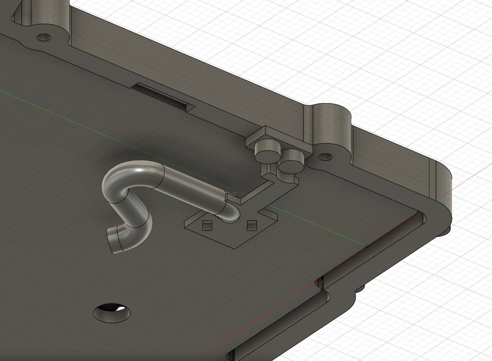
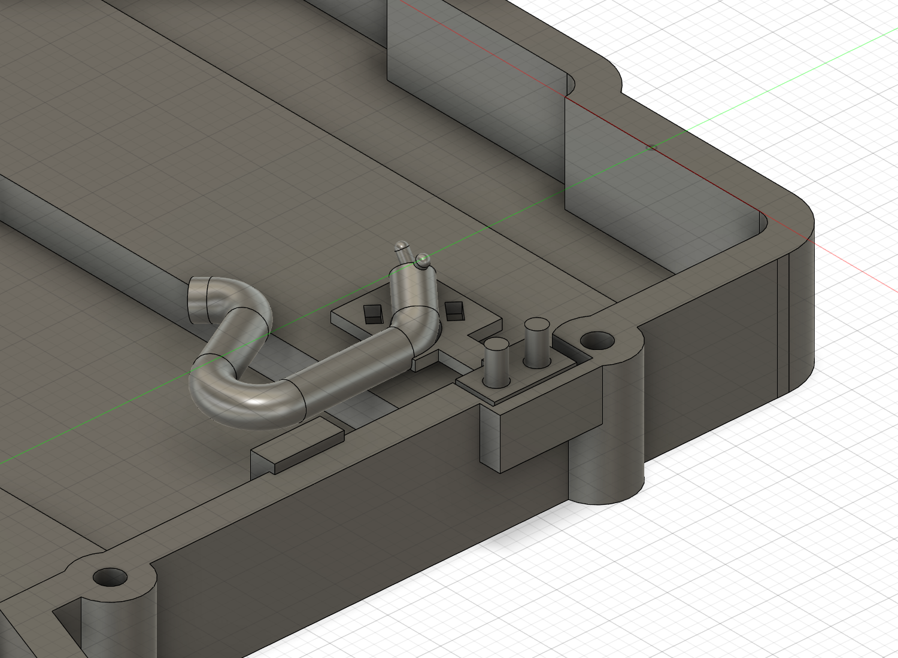

# ケース固定の配線保持ブラケット（v26）

**v29での更新:** [電池固定の簡素化](simple-battery-mount-and-right-wall.md)を優先。専用受け・配線ブラケットは必須部品から外した。電池は基板側固定案、旧下側移動姿勢は履歴。以降は導入当時の記録。

**現行v27への追記:** [再点検](design-consistency-review.md)で上ケースの2下穴の外側を補強し、上下ケース材をJLCCNC6061-T6へ仮設定。以降はv26導入時の記録。最新STEP/F3Dはv27を使用。

更新: 2026-11-09。導入時はクラウドv26、保存・処理完了・未保存変更なし。ユーザーから被覆込み外径は約1 mm／本と確認した。電池42×20×5、各線40 mm・基板電池パッド直付け、LP向き補正とpin3除外は維持。

**上ケースに独立ねじで留める非金属ブラケットと、結束材を通す保持部を試作形状へ追加した。PCBへの接着は不要。保持力・線への損傷・剛性・製造成立・連続開閉は未認定で、発注用ではない。**

## 選んだ構成

PCB下面の6×2 mm接着面案は、実機の銅箔・ビア・レジストが未確認のため比較履歴へ退避。PCB端とケースの狭い隙間を薄い爪で回す案も採らず、ケース側の2ねじ固定を選んだ。基板・元PCB・第三者参照の加工は行わない。

図はPCB輪郭参照、非金属ブラケット、名目ねじ包絡、D3の配線比較包絡。銀色の太い管は実線ではなく、結束材の全経路や実ねじの六角穴も再現していない。

| 対象 | 公称候補・検討値 |
| --- | --- |
| 基板側固定 | 上ケースへ独立したM1.6×4候補2本、下面から組立 |
| 軸XY mm | (12.8, −25)、(12.8, −21.5) |
| 上ケースの下穴 | D1.25、円筒深さ3.6、組立Z−1〜2.6、ねじ山は未モデル化 |
| ブラケットねじ通路 | D1.8、通し部1.2、頭座・工具逃げD3.4 |
| ねじ頭比較包絡 | D3×高さ1.6。実規格・供給品・トルクは未確定 |
| 配線受け | 仮D3束に対するD3.4の開いたサドル、名目半径差0.2 |
| 結束材の通し穴 | 2.2×1.1 mmを2か所。線の進行方向に合わせた向き |
| 部品 | 非金属候補、単一ソリッド、体積約92.0573 mm³ |
| 下ケース逃げ | X10.7〜14.9、Y−27.2〜−18.6、Z−5.2〜−1 |
| 下ケース局所補強 | X13.8〜16、Y−27.6〜−18.2、Z−5.4〜−1 |
| 残る局所外壁 | 名目1.1 mm。強度・DFMの認定値ではない |

[Panduitの一次資料](https://www.panduit.com/content/dam/panduit/en/support/catalogs/2019-ASEAN-Industrial-Electrical-Infrastructure-Preferred-Parts-Catalog.pdf)で1.8 mm幅の小型結束材が存在することを確認し、サイズクラスの比較に使用した。具体的な品番は採用未確定。帯厚0.8 mmと頭3.6×3.3×2.8 mmは今回の空間比較用の仮定で、製品公差や適合保証ではない。

約1 mmの線2本に、D3の管そのものを圧縮して合わせる前提ではない。実被覆の束をサドルで支え、結束材を調整して保持する候補。固定力を得る締付け量・許容引張り力・絶縁被覆への面圧は決めていない。結束工具で強く締めればよいという判断はしない。

## ケースに加えた変更

上ケースの既存側壁へ2つの下穴を追加。下ケース内側にブラケットのための逃げを作り、その外側へ局所補強を追加した。ケースの最大外接寸法は変更していないが、**右側壁の局所外形は意図的に変更している**。外側への新規材料を一律に否定する検査ではなく、追加した補強範囲と名目1.1 mm残壁を個別に確認した。

最初の操作では補強が別ボディとして残り、最初の逃げ加工の対象から漏れた。体積検査で約6.816 mm³のブラケット衝突を検出し、補強を下ケースへ明示的に結合してから逃げを加工し直した。さらにねじ頭の一部がブラケットのウェブと重なったため、内側の補強ウェブとD3.4の頭座／工具逃げを追加した。最終的に上下ケース・ブラケットは各単一ソリッドである。失敗状態は保存していない。

この処理は「空隙は追加材の後にも検査する」「部品間検査とボディ数・残壁検査を別にする」ための回帰項目として残す。

## 確認した範囲

- ブラケット対ケース・PCB・詳細XIAO・詳細Choc／ソケット・電池・受け・絶縁材・D3配線包絡の指定重複なし。
- 新しいねじ2本の軸・頭、および仮の結束材頭／下面帯の空間を検査。上ケースのタップ下穴に入るねじ外径は意図した関係として除外した。
- 新D1.25下穴2個・D1.8通路2個の閉塞なし。D3ねじ頭の座面環状部に必要な材料を名目立体で比較し、欠損なし。
- 底を外した条件で新2軸へのD1.8／D3直線工具包絡を検査。柄・手・実六角穴は未再現。
- 指定した1.1 mm残壁の全矩形立体に欠損なし。下ケースの最大BBoxは変更前と一致。
- 既存M2の4通路・頭座・上側下穴、支持4か所／逃げ8フィーチャー、スタンド2収納の空隙・残肉2 mm、M2頭座の名目0.9 mm環状壁を再検査。
- 詳細Choc対ケースの指定検査、主要62ソリッドと配線・確認用空間の検査を再実施。タイムライン警告0。
- 42 mmの連続接地辺を維持。420ソリッドの位置範囲が接地辺よりX正側・Z上側にあることから、指定したX正側を上げる理想剛体平面への侵入がないことを確認。実スタンドの角度・接地安定性の認定ではない。

ねじの名目突出は2.8 mm、円筒下穴の底余裕は0.8 mm。仮118°ドリルの先端追加深さは約0.376 mm。有効ねじ掛かりは入口面取り・タップの不完全ねじ・公差を含めて未認定。1.1 mmの局所外壁、約0.9 mmの受け板、片持ちアームも、材質と製法・荷重試験を決める必要がある。鋭い縁・スロット縁の仕上げと被覆保護は加工前の残課題。

## 40 mm線と組立・整備

束の末端円弧と直線は、底を0／2／5／8／10 mm下げた5つの独立姿勢で同じ座標を保つ（最大差は浮動小数点誤差程度）。固定する範囲をこの一定部分へ置くことで、基板はんだ側の位置を変えずにループ側へ変形を分配する候補とした。新ブラケットを固定対象に含めて各姿勢を再検査し、公称D3に必要な空間を確認した。

ただし、姿勢間を実線が連続して移れること、結束した状態の曲げ・摩擦・ねじれ・引張り荷重、端部の曲げは未確認。約1 mm／本はユーザー概寸で、被覆材とメーカー最小曲げ半径は不明。仮R3を実線へ承認したものではない。

組立候補は、PCB／スイッチと上ケースを別に支持し、底を外した状態でブラケットを上側へ2本のねじで固定してから、被覆部分を仮保持する順とする。線を強く引いて固定位置を作らない。閉じる際はループを内側へ収め、合わせ面やねじ軸へ挟まないよう確認する。

底ケースを外してもブラケットは上側に残る。電池受けを底から解放する際は電池・基板側を支持し、線で底を吊らない。PCBを取り外す際や電池交換では、結束部も解放する手順が必要になる。結束材の全通し方・頭の位置と工具による解放・被覆損傷を避ける作業は、実物で確認する。

## 保存と次の確認

変更前v25 F3Dと、上v22／下v20のSTEPを `cad/design/checkpoints/` に退避。現行の全体F3D、上下ケースSTEP、[ブラケット単体STEP](../cad/design/wire_strain_relief_case_bracket_NONMETAL_NOT_FOR_MANUFACTURE_LOCAL.step)、主JSONと承認済み構成を更新した。非金属候補をアルミケースの加工STEPへ混在させない。

初回の下ケースSTEPはAPIの成功応答にもかかわらず実体を含まなかったため、成果物チェックで不合格とした。v26の各部品ネイティブBRepを一時的な独立デザインのルートへコピーして3ファイルを再出力し、STEPを再読み込み。各1ソリッド、元モデルとの体積差は上下ケースが約5×10⁻¹⁰ mm³以下、ブラケットが約0.0000335 mm³、部品ローカルBBox差は約4×10⁻¹⁴ mm以下だった。これは交換データの一致確認で、公差や加工精度の認定ではない。元のクラウド設計は変更していない。

空出力は `checkpoints/v26_lower_EMPTY_FAILED_EXPORT_NOT_MODEL.step` に診断用として区別して残した。通常の再開や見積りには使わない。[STEP再読み込み検証](case-wire-bracket-step-roundtrip.json)、`export-verify-current-case-steps.py` を参照。非ルートComponentのexport成功応答だけを完了条件にしない。

ブラウザ上は電池グループ内に実体候補5個＋確認用12個。新ブラケットはこのグループ内でも上ケース固定であり、電池受けと一緒に移動する部品ではない。旧PCB接着候補面は `RETIRED_PCB_BONDING_ALTERNATIVE_…` として非表示保持。

最終587構成記録、46 Choc配置、23ステム上端、pin3不在、元ソース不変を確認。未コミット・未push。次は実線と結束材の通し方・解除、材質と保持力を詰め、スタンド実運動と接地安定性の残条件へ進む。右ケースは左側の未認定条件を明確にしたうえで着手する。

この段階のスクリプトはv25用の一回限り処理で、現行へ再実行しない。作成、補強結合／頭座の補正、検証、最終保存を分離している。

[事前比較](case-wire-bracket-preflight.json)、[変更記録](case-wire-bracket-development.json)、[局所検証](case-wire-bracket-verification.json)、[接地辺と理想平面](case-wire-bracket-contact-verification.json)、[最終保存](case-wire-bracket-final-verification.json)。
