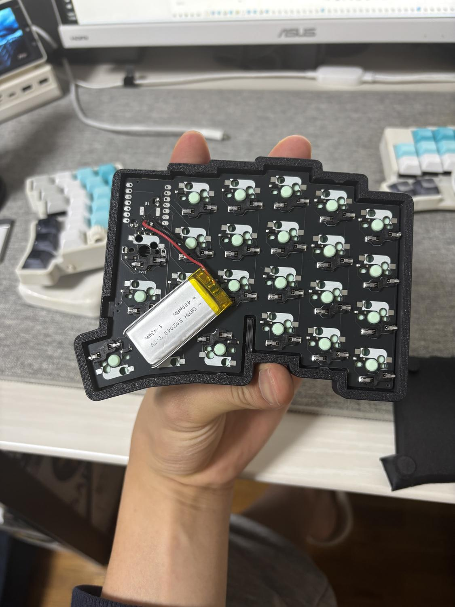
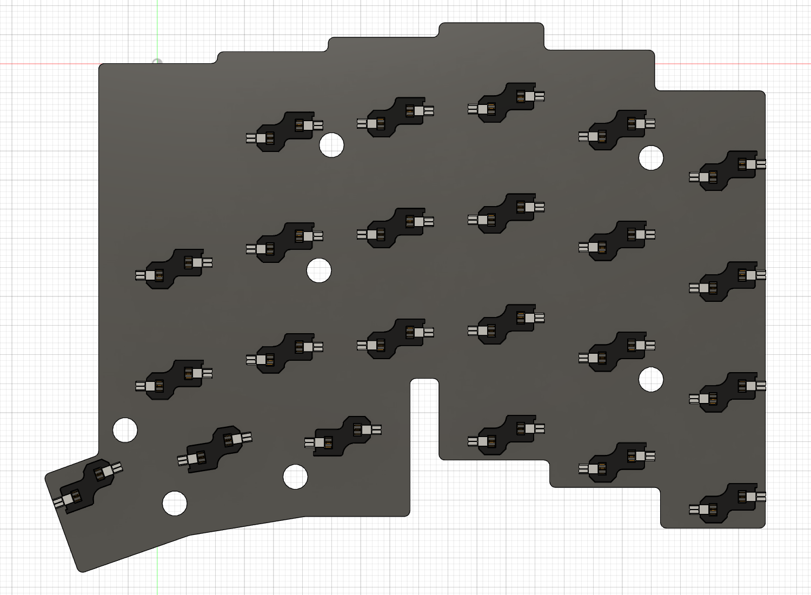

# LP版Chocの向き合わせ修正（v20）

更新: 2026-11-08。ユーザーの指示どおり、**LP版のChoc側だけを配置基準**とします。現行クラウドv20、保存・処理完了・未保存変更なし。MX側の穴・ランドをChoc配置の基準にはしません。

## 原因

部品CADの基準方向とKiCadフットプリントの角度を同一視し、必要な180°の補正を入れ忘れていました。キー中心は合わせていましたが、実物の端子・ソケット方向の照合が不足していました。公開PCBの不具合とは判断しません。

未変更の[公開v2左PCB](https://github.com/kumamuk-git/roBa/blob/69fc34d2996e6aaf63b29f6a58d104b32669f610/pcb/v2/roBa_L/roba_L.kicad_pcb)では、通常部はSW_MX（およびエンコーダ兼用）、親指3キーはSW_MX_Choc。MX穴・ランドとChoc穴・ランドは区別が必要です。Spring MINIの販売元も[MXフットプリント非互換](https://shop.talpkeyboard.com/products/kailh-spring-mini-chocv2)と記載しています。

旧プロジェクトの `balo43_L` v5を読み取り専用で検査。PCBボディにはJoin押し出し（穴埋め相当）、D3穴とパターン等の履歴があり、通常キー部にもChoc側の穴が追加された状態でした。旧PCBの座標をU1基準へ合わせ、各キーのChocソケット受け2箇所を照合すると、**23キーすべてで現行角度＋180°が旧穴位置に0.0001 mm以内で一致**しました。現在の角度のままでは一致しません。

これは旧モデルの機械的な穴位置との整合であり、旧基板の電気配線や現物PCBリビジョンを認定する比較ではありません。旧3Dの厚さは1.51 mm、現行の仮PCBは1.6 mmで、同一の実装済み基板だとは扱いません。旧データは変更せず、検査用に開いた文書も保存せず閉じました。

## 修正

- 詳細Chocスイッチ23個・ソケット23個を、それぞれのキー中心に対して180°反転。ソケットのオフセットもキー中心を基準に反転し、向きだけその場で回す処理にはしていません。
- キー中心と高さ（PCB下面0、スイッチ着座1.6、ソケット基準−1.85、解放ステム上端10.2 mm）は維持。46配置をキャプチャし、再計算後の46原点と23ステム上端を確認。
- 正しい向きで検査し、左端PCB支持1とソケット端子の衝突を発見。支持1をY＋方向へ8 mm移動し、上側の対応する逃げと厚さ0.2 mmの仮絶縁材も一緒に移動。新支持範囲X−106.12〜−103.82、Y−53〜−45 mm。
- キー開口・キーキャップ包絡は180°対称の形状なので、開口中心を動かしていません。MX版の追加設計や、元PCBデータの穴加工・上書きは行っていません。

上図はソケットとPCBの輪郭参照です。現行のPCB参照ボディには機能穴・ランドが省略されており、この画像だけで穴・パッドとの一致やはんだ付け成立を判定しません。

## 検証と制限

修正後の向きで、詳細スイッチ／ソケット対ケース・カバーの検査、主要62ソリッド、詳細ソケット対支持絶縁材・電池関連・配線等の指定検査を実施し、外部への衝突0件。部品CAD内部の115重なりは別扱い。M2全4箇所の通路・頭座と名目ねじ、スタンド収納空間・残肉2 mmも再検査。42 mmの接地辺は維持。タイムライン警告0件です。

ChocV2 Redの作者モデルはSpring MINIそのものの厳密な製品モデルではありません。旧穴とソケット受けは上記許容内で一致しますが、汎用スイッチモデルの2つ目の端子中心はソケット／旧穴に対し約0.1 mm異なります。第三の突起等を含む全ピンのPCB通過・実ランド・実機リビジョンまで認定したものではありません。[作者のモデル説明](https://koktoh.hatenablog.com/entry/2023/06/05/173318)も参照。

全体F3Dと、支持・逃げを変更した上下ケースの単一ソリッドSTEPを更新済み。元参照6点と第三者部品STEPは未変更。修正前は `cad/design/checkpoints/v05_cloud_v19_before_choc_orientation_correction.f3d`、旧配置JSONは `docs/choc-v2-placement-v19-before-orientation.json` に保持。未コミットです。

[向き修正の記録](choc-orientation-correction.json)、[旧穴との照合](old-vs-current-choc-pin-orientation.json)、[支持部の修正](choc-lp-support-correction.json)、[現行46配置](choc-v2-placement-verification.json)、[詳細部品の検査](detailed-choc-fit-verification.json)。

今後はフットプリント角度だけで部品の向きを決めず、Chocの穴・受け・端子の非対称な位置を照合すること。旧配置を使った検証記録は履歴として扱います。
