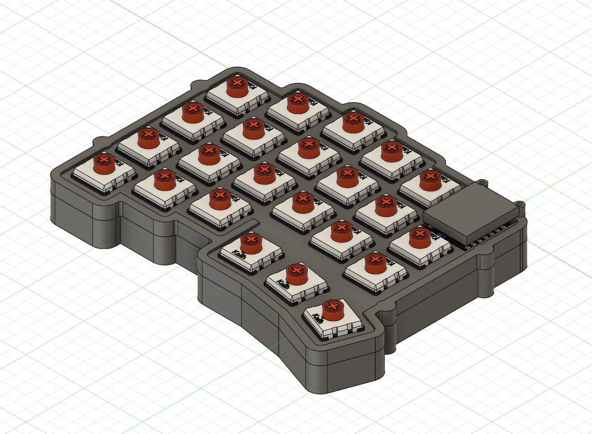
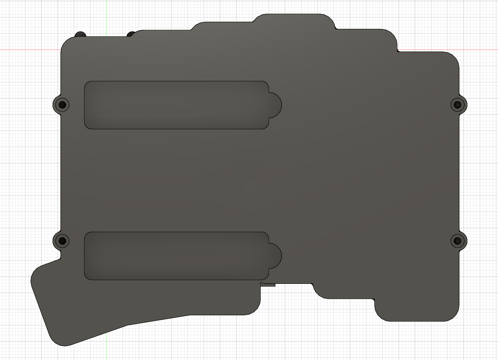

# Choc V2詳細参照・カバー仮固定・スタンド指掛かり

更新: 2026-11-08。現行はFusion `02_design/left_case_two_stands_v05_NOT_FOR_MANUFACTURE` のクラウドv9。処理完了・保存後未変更を確認し、F3Dと上下・カバーの部品別STEPを更新した。製造前の検討用。

スイッチの色・外観は作者配布Choc V2 Redの参照。使用するSpring Miniの外観を再現した画像ではない。部品モデル: © koktoh、CC BY-NC-SA 4.0。[取得元とライセンス](../cad/reference/third-party/koktoh/manifest.json)。

## 既製部品CADの再利用

ユーザー確認によりChoc V2として設計を継続。[koktoh/keyswitch_model](https://github.com/koktoh/keyswitch_model)のChoc V2 RedとChocソケットを固定コミット`2b6bcfac0032f1547e27b18b9a897e065e544b37`から未変更で取得し、23キーへ共有コンポーネントとして配置した。スイッチ8ボディ×23、ソケット7ボディ×23。元ファイルのハッシュ・取得元をmanifestに記録。別ライセンスの参照素材として管理する。

スイッチのモデル基準面Z=0をPCB上面Z=1.6へ合わせると、非押下時の軸上端Z=10.2となる。PCB上面から8.6 mmであり、Spring Mini図面から求めた公称高さと一致する。汎用Choc V2 RedとSpring Miniの材質・端子・爪等の細部まで同一と認定したわけではない。

ソケットは[作者説明](https://koktoh.hatenablog.com/entry/2023/06/05/173318)のPCBに対するZ基準に合わせ、ネイティブZを−1.85へ配置。モデル内接点座標からXYを(0,−5.9)だけ移し、各キーと同じ回転を与えた。実機のソケット型番・取付方向・基板穴との照合は未完了。

初回は配置変更を履歴へ確定する前の再計算で位置が戻り、ケース外に並んでしまった。画像確認で発見し、全46インスタンスの位置をスナップショットに記録してから再計算する手順へ修正した。46原点と23軸上端Zを検査済み。誤配置時の干渉0件は採用せず、正しい配置で検査をやり直した。[配置検証JSON](choc-v2-placement-verification.json)。

## 詳細ソケットで見つかった支持部干渉

正しい配置では、SW9付近のソケット樹脂と基板縁支持4に0.295982 mm³の干渉があった。干渉範囲Y=6.254〜6.319で、粗い包絡では検出できなかった。[変更前検査](detailed-choc-fit-before-support-relocation.json)のkeyがnullなのはAPI結果の部品名からキー名へ対応付けできなかったためで、SW9は配置座標から特定したもの。

支持4をX=−60〜−54からX=−66.3〜−60.3へ移設。Y=6.254〜8.554と支持上端Z=−0.2は維持し、上側にも周囲0.2の対応逃げを追加した。旧支持押出は履歴で抑制して残す。支持中央の20点がPCB材料の下にあり、支持材料内にあることを確認した。これは銅箔・実装部品・絶縁の確認ではない。

ソケット樹脂外接範囲とのX方向の公称差は約0.506 mm。再検査ではスイッチ・ソケットとも上下ケース、カバー、電池余裕、MCU仮包絡との体積干渉0件。[詳細部品の最終検査](detailed-choc-fit-verification.json)。基板参照はスイッチ機能穴を省略した輪郭モデルなので、端子・中央突起とPCBとの交差を実機の不適合として判定していない。

## カバー前側の仮固定

USB左右に2本の小ねじで固定する比較案を追加した。カバー後部は前側固定から張り出す構造で、材質・剛性・長期変形は未検証。

| 項目 | 比較寸法 mm |
| --- | --- |
| ねじ軸 | (−8, 3.8)、(8, 3.8) |
| 上側の固定座外径 | 3.6、上端Z=4.5 |
| カバー脚外径 | 3.6、Z=4.5〜8.0 |
| カバー通し穴 | 1.8 |
| ねじ候補 | M1.6×0.35、首下6 |
| 上側パイロット | 1.25、円筒深さ3.2、穴底Z=1.3 |
| カバーのねじ頭座面 | Z=8.0 |
| 頭の仮外形 | 直径3.2、高さ1.6。購入品未選定 |
| 頭逃げ | 直径3.8、外縁に開放 |
| 首下6の公称先端 | Z=2.0 |
| 上側への公称突出長／穴底との差 | 2.5／0.7 |

カバー脚を追加したため、18.8角の仮キャップ包絡との最小平面隙間は約0.719から**0.605 mm**へ変わった。D=3.0の仮押下包絡、USB予約空間との体積干渉は0件。ねじ軸・頭の仮包絡も、カバー・下ケース・PCB・電池・MCU・USB・押下包絡との干渉なし。ねじ山を省略した外径円筒とパイロットとの意図した重なり2件は別扱い。

突出長2.5は完全ねじ部の有効掛かり保証ではない。タップ食付き・穴先端・面取り、公差、樹脂のクリープ、締付トルク、実ねじ頭の規格を確定する必要がある。[固定部検証](cover-front-fastening-verification.json)、[ねじ包絡検証](cover-screw-envelope-verification.json)。下穴径の比較根拠は[OSG資料](https://www.osg.co.jp/media_dl/flier/file/n_102.pdf)、止まり穴の底余裕の確認先は[JLCCNCガイド](https://jlccnc.com/help/article/threaded-hole-guideline)。

## 横向きスタンド2本の指掛かり

本体収納56.8×14.8×深さ3.7・R2.2は維持。左端中心(−50,−63.6)、(−50,−17.1)に直径8・深さ3.7の円形切欠きを追加し、元ポケットの左へ4 mm広げた。裏側には直径12の補強を足し、くぼみ奥との名目残肉2 mmを維持。補強が元収納へ張り出すのを底面画像で発見したため、v9で元ポケットを同じ寸法で切り直し、張出し106.546 mm³を除去した。指掛かりと残肉24点、元収納の空間36点を確認。途中のv8を採用しない。

左端を開く仮定であり、スタンドの現物ヒンジ・爪位置、テープ厚、開閉軌跡、指の入りやすさ、接地安定性は未検証。切欠きを作っただけで確実に開くとは扱わない。[指掛かり検証](stand-finger-access-verification.json)。

## 保存・検証と次の作業

ケース／PCB／電池／MCU仮包絡／粗いスイッチ上下包絡の52ソリッドは干渉0件。詳細Choc・ソケット、詳細MCU、USB、仮キャップ掃引、仮ねじ包絡は目的ごとに別検査した。詳細MCU内部12件・スイッチ内部115件の重なりはケースとの干渉と区別。履歴エラー・警告0件。[最終状態JSON](choc-reference-final-verification.json)。

チェックポイントはcad/design/checkpointsに保持。加工候補の3つのSTEPには参照部品を混ぜず、部品単位の単一ソリッドで出力。組立F3Dには他者ライセンスの参照部品を含む。cad/sourceの元6点と旧XIAOは未変更。今回分は未コミット・未push。

次はカバーのリセット操作・後部の支持、上下の位置決めと基板絶縁、スタンド開閉の仮軌跡とテープ厚を詰める。その後に右COROPITの取付基準と外形を作る。発注前には実物合わせと加工条件の確認が必要。
