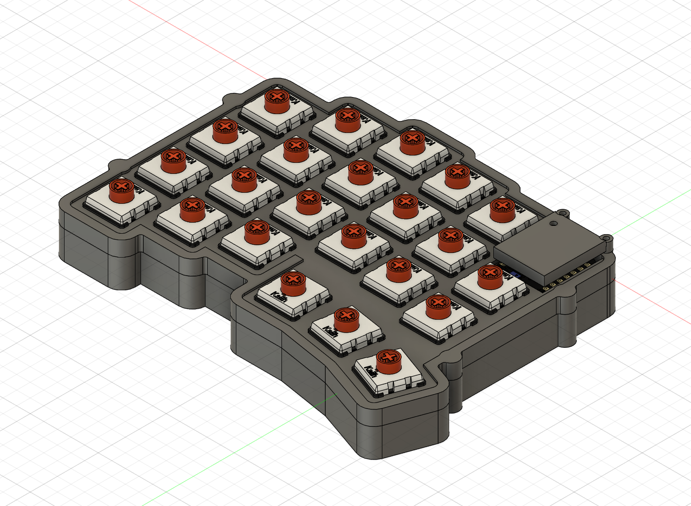

# コンポーネントと表示の整理

更新: 2026-11-08。対象は `left_case_two_stands_v05_NOT_FOR_MANUFACTURE`、クラウドv17。保存・処理完了、未保存変更なし。ユーザー記載のv50ではなく、既存の同じv05ファイルを更新しています。新規のクラウドファイルは作成していません。

**現行v28追記:** 以下はv17の表示履歴。現行は電池実体候補5個＋確認用14個（個別D1線と開姿勢を追加）、ブラケットは電池グループ内でも上ケースへ固定し、下ケース移動に追従させない。JST／旧PCB接着案は履歴。[現行案内](next-session.md)、[再点検](design-consistency-review.md)を優先。

## v17当時の階層と通常表示

| グループ | 内容 | 通常表示 |
| --- | --- | --- |
| `OLD_NOT_CURRENT` | 旧電池・配線等8個と、旧電池包絡・XIAO包絡・上下スイッチ包絡4個 | OFF |
| `BATTERY_ASSEMBLY_CELL42_WIRE40_PROVISIONAL` | 電池42×20×5、受け、ケース〜受け粘着層、受け〜電池粘着層 | ON |
| 上記内の `CLEARANCE_STUDIES_NOT_PARTS` | B1仮包絡、仮プラグ作業空間、設置空間、粘着タブ空間、余長用空間、配線D3包絡 | OFF |
| `CHOC_SWITCHES_AND_SOCKETS_REFERENCE_23_PAIRS` | 詳細スイッチ23個・ソケット23個 | ON |

ケース上下、MCUカバー、基板輪郭参照、詳細XIAO、PCB支持の仮絶縁材もON。USB・キーキャップ押下包絡・仮ねじ・リセット工具・局所試験片はOFFです。電池の親をOFFにすれば電池一式を一括で隠せます。電池の空間モデルを調べるときは `CLEARANCE_STUDIES_NOT_PARTS` と、その中の必要なモデルをONにしてください。内部を確認する場合は、遮っているケース上下・PCB等をOFFにします。

旧データは削除せず保持。`OLD_NOT_CURRENT` の粗いXIAO・スイッチ包絡は、従来の保守的な干渉検査で引き続き参照します。旧案であることと検証工具として使うことを区別し、製造部品には含めません。現行のスタンド局所試験片は旧案扱いにせず、独立した試験用データとして残しています。

## 検証と退避

整理前の603件の構成記録について、名前（旧グループの改名を正規化）・変換行列・ボディ数・各ボディ体積を整理後と照合し一致。削除0件。主要62ソリッド・配線・詳細ソケット・仮作業空間の関連干渉0件、タイムライン警告0件。形状・寸法・部品位置は変更していません。42×20×5 mm電池、線40 mm、仮の角から約31.08 mm経路という前段の設計条件を維持しています。実物適合は引き続き未確認です。

整理前のF3Dは `cad/design/checkpoints/v05_v16_before_authorized_cleanup.f3d`、現行全体は `cad/design/left_case_two_stands_v05_NOT_FOR_MANUFACTURE.f3d`。部品別STEPは形状変更がないため再出力していません。元STEP6点はハッシュ一致を確認し、変更していません。

[検証JSON](component-organization-verification.json)、[電池グループ記録](battery-browser-group-verification.json)、[干渉検査](internal-retention-fit-verification.json)。前回のグループ化失敗・自動承認レビューによる停止は履歴です。今回はユーザーの再試行指示を受け、現状照合・退避後に整理を完了しました。

次は[電池配線の実装条件](battery42-layout-development.md)のうち、出口・曲げ半径・コネクタ端を詰め、ケースを閉める際の挟み込みと取り外し作業性を検討します。今回分は未コミットです。

2026-11-08追加監査: [M2穴の部分閉塞とスタンド裏当ての外周張り出し](v17-fastening-and-overhang-audit.md)を新たに確認。未修正の設計・検証漏れ。従来の指定部品間の体積重複0件は、穴の連続性や外形逸脱まで保証しない。次の機能追加前に修正する。クラウド形状はv17のまま。

2026-11-08追記: この監査の2件はクラウドv18で修正済み。[修正内容と検証範囲](stand-and-M2-correction.md)を参照。v17の不合格記録は履歴として保持します。

2026-11-08: クラウドv19で[接地辺を連続化](continuous-contact-edge.md)。元の辺から2.5 mm外側・長さ42 mm、ねじ座の既存外接寸法内で上下ケースを揃えた。机下侵入の理想姿勢検査・穴検査・残肉・指定部品間検査を通過。実物安定性は未認定。
