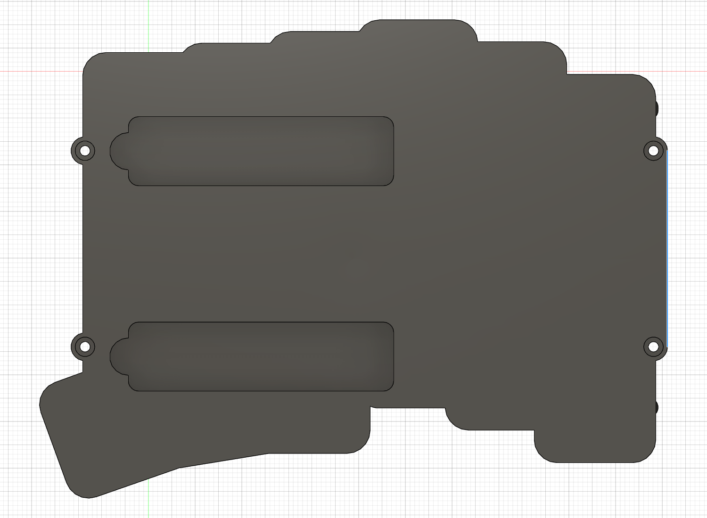

# スタンド使用時の連続した接地辺（v19）

更新: 2026-11-08。`left_case_two_stands_v05_NOT_FOR_MANUFACTURE` のクラウドv19へ保存、処理完了・未保存変更なしを確認。ユーザー指定の辺側を、ねじ座2点ではなく連続した直線で接地できる形状へ修正しました。

## 形状の変更

選択されていた辺は下ケース底、X=−108.619997、Z=−11.5、Y約−56.042〜−19.958 mmの直線でした。ねじ座外端はX=−111.119997まで2.5 mm出ており、元の辺を通る机の平面を想定すると、そちらが先に当たる形状でした。

ねじ位置を動かしたり、座ぐりの壁を削り落としたりせず、ねじ座の間の壁を外端へ合わせて連続させました。**接地辺の位置は元の選択辺から外へ2.5 mm移っています。** もともとのねじ座の外端内へ収めたので、ケース全体の最小／最大XYZは変更していません。上下ケースで同じ外形へ合わせ、段差のある張り出し板にはしていません。

| 項目 | 修正後 |
| --- | --- |
| 接地辺 | X−111.119997、Z−11.5、Y−59〜−17 mm |
| 連続長 | 42 mm（単一の直線BRep辺） |
| 元の選択辺からの移動 | X−方向へ2.5 mm |
| ねじ軸・通路・頭座 | 位置維持、D2.2通路・D4.2深さ2.2の頭座を追加材反映後に切り直し |
| 上側パイロット | D1.6・深さ4.5 mmを切り直し |
| 上下ケース最大外接寸法 | 変更なし |

底面図では座標の左右が反転して見えます。青線が今回作った42 mmの辺です。

## 接地・干渉の検証範囲

机を剛体の理想平面とし、X正方向側が持ち上がる姿勢を仮定。接地辺を通る平面を `sinθ(X−接地X)+cosθ(Z−接地Z)=0` として、5・7・10・17・20・30°で上下ケースと仮M2ねじの机下領域への侵入体積が0であることをブーリアン比較しました。

現在の実体候補438ボディの精密境界ボックスも、接地辺に対してX・Zとも机の上側へ入る象限内であることを確認。これは上記方向へ持ち上げる理想姿勢での補助的な幾何検査です。実物スタンドの実測角度を確認した値ではありません。

M2全4箇所の通路・頭座・上側パイロットは閉塞0、仮ねじ軸／頭と下ケースの衝突0、座ぐり周囲の半径方向0.9 mmの名目環状材料の欠損0。収納空間・残肉2 mmの立体検査、主要62ソリッドと配線・ソケット等の指定組み合わせの検査も通過しています。スタンド位置、収納寸法、電池42×20×5・線40 mmの配置は維持。

全コンポーネントの変換行列と表示設定を変更前の605構成記録と照合し維持、上下ケース以外の体積も維持。下ケース36931.9075 mm³、上ケース13569.4301 mm³へ更新。タイムライン警告0件です。

## 保存と未確認事項

全体F3Dと上下ケースの単一ソリッドSTEPを更新。修正前は `cad/design/checkpoints/v05_cloud_v18_before_continuous_contact_edge.f3d` に退避。元参照は未変更。未コミットです。

接地辺の面取り・Rや保護材はまだ適用していません。それらを追加する場合は接地線・高さを再検討します。実スタンドの脚・ゴム・開閉軌跡、机のたわみや滑り、転倒安定性、加工公差・締結強度は未確認です。「接地線と指定条件での幾何検査が通った」と扱い、実物の安定性や発注適合まで保証しません。

[形状変更記録](continuous-contact-edge-development.json)、[接地の検証](continuous-contact-edge-verification.json)、[ねじ通路の検査](fastening-and-overhang-current-audit.json)。
