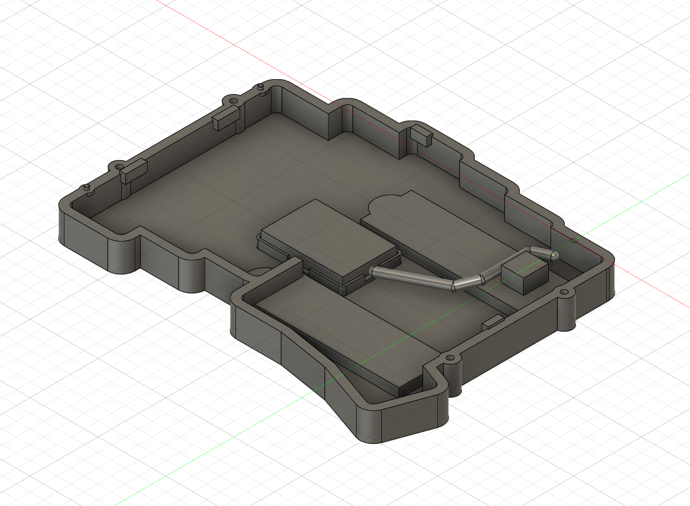
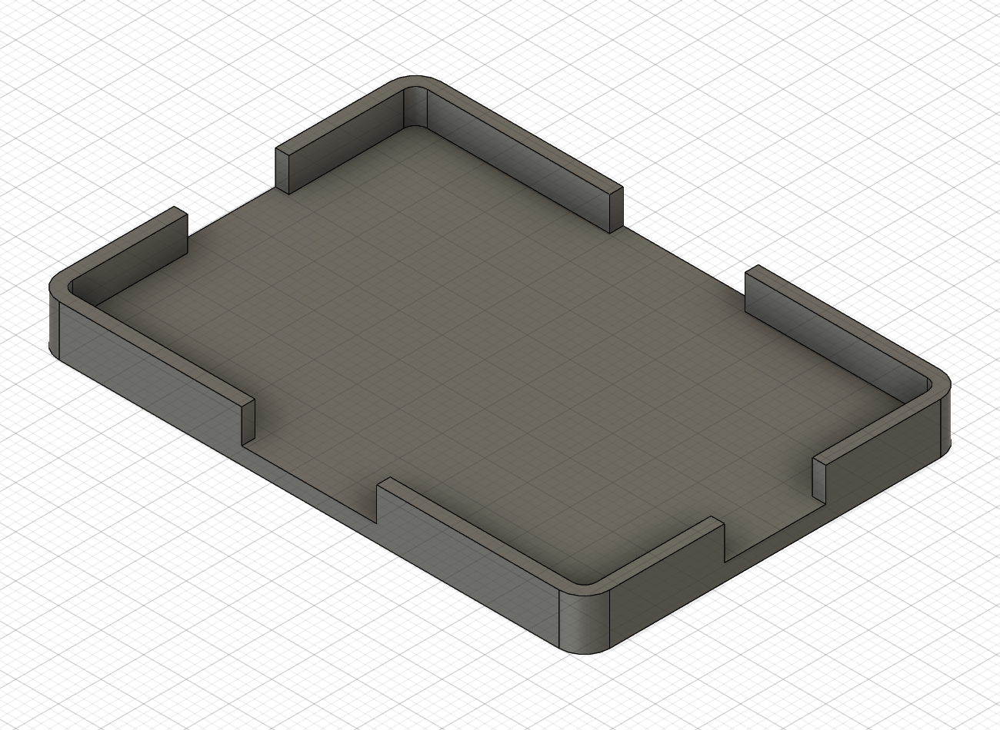
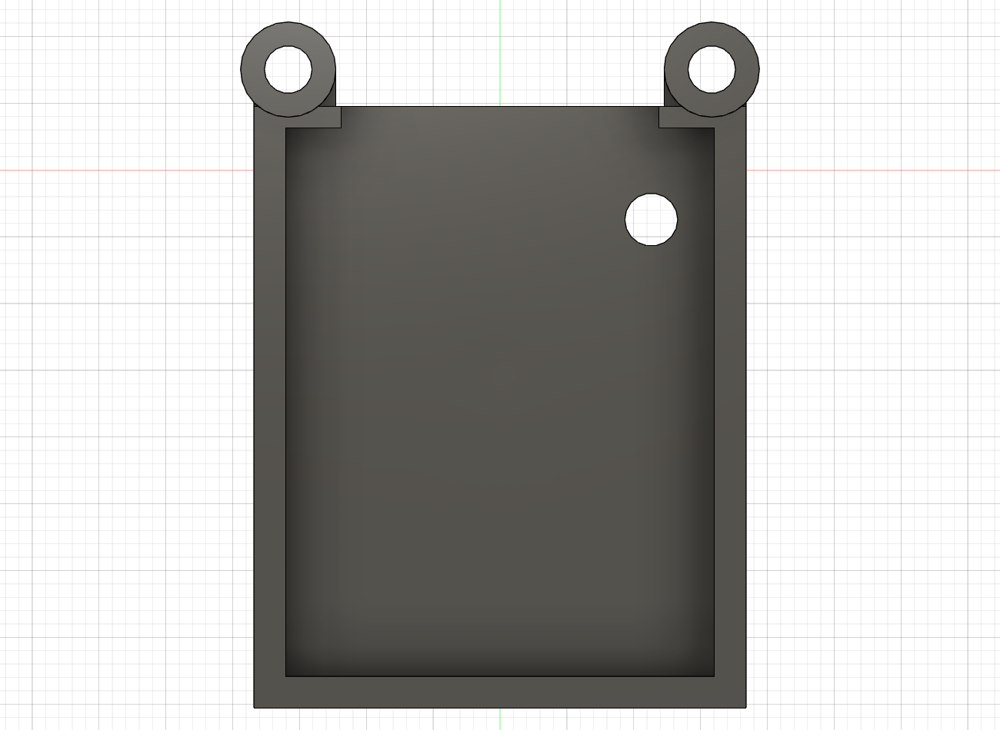

# 基板絶縁・電池受け・配線空間・カバー補強

更新: 2026-11-08。現行は同じ`left_case_two_stands_v05_NOT_FOR_MANUFACTURE`のクラウドv15。保存・処理完了・保存後未変更を確認。素材・現物適合が未確認の検討形状で、発注用ではない。元の参照と旧XIAOは変更していない。今回分は未コミット・未push。最新のv15補正と現物情報は末尾の節に記載。以下の70.1 mm配線案は約50 mmの実配線に対して不成立として保持。

図の電池はユーザー概寸の直方体、配線は予約空間、右側コネクタは図面・フットプリントからの包絡である。現物やメーカーの詳細CADを再現した画像ではない。

## 基板縁の絶縁材

4つの支持面Z=−0.2からPCB下面Z=0まで、厚さ0.2 mmの絶縁材スタックを仮配置した。接着層込みの必要空間であり、フィルムの製品、材質、圧縮量、絶縁性能を決めたものではない。公開v2と実基板の銅箔・部品位置が一致するかは未確認なので、絶縁済み・支持適合済みとは扱わない。

支持4の移設位置は維持。スタック4点と上下ケース・PCBの関係を幾何検査し、詳細ソケットとの体積干渉なしを確認した。実際のスタック厚が変わればPCB高さとスイッチ着座も変わるため、単なる追加余裕として積み増さない。

## 別体の低い電池受け

電池を金属の縁やねじで挟まず、取り外せる粘着材と非金属受けを比較する。[AdafruitのLiPo取扱い資料](https://learn.adafruit.com/li-ion-and-lipoly-batteries/conclusion)を一般的な機械保護の参考にし、パウチを押しつぶす・曲げる保持は採らない。この資料はユーザーの電池の仕様や膨張量を定めるものではない。

| 項目 | 仮寸法 mm |
| --- | --- |
| 受け外形／内側 | 32.6×22.6／31×21 |
| 底／側壁／側壁高さ | 1.0／0.8／2.0 |
| 外形位置 | X−66.3〜−33.7、Y−51.3〜−28.7 |
| 受け底面／上面 | Z−9.3／−8.3 |
| ケースと受け間の粘着層 | 0.2、Z−9.5〜−9.3、6×18の2か所 |
| 受けと電池間の粘着層 | 0.2、Z−8.3〜−8.1、6×14の2か所 |
| 電池本体の仮包絡 | 30×20×4、X−65〜−35、Y−50〜−30、Z−8.1〜−4.1 |

底厚は最初の0.5から1.0へ変更し、粘着層・電池も0.5だけ上へ揃えた。製法や強度を承認した値ではない。電池寸法は概算で、封止部・端子・保護回路・最大厚さ・配線出口を含む最大包絡は未確認。側壁は低いガイドで、上へ抜けないロックではない。粘着保持と交換方法の試験が必要。

配線出口が未確認なので、短辺側に幅6、長辺側に幅8の開放部を設けた。Xが大きい側に粘着タブの初期アクセス12×4×0.2を仮予約。[3Mの交換・再作業性の説明](https://www.3m.com/3M/en_US/consumer-electronics-us/applications/electronics-bonding/design-challenges/)等を参照し、引張剥離のような方式を比較するが、実際のテープ厚・剥離方向・必要引張距離は製品選定後に確認する。予約した12 mmだけで剥がし切れる保証ではない。

受け単体は`cad/design/battery_carrier_provisional_NONMETAL_NOT_FOR_MANUFACTURE_LOCAL.step`に出力。非金属部品の候補として別管理し、アルミケースのSTEPへ混ぜない。

## B1コネクタとスタンド裏の床

固定コミットの[公開v2左基板](https://github.com/kumamuk-git/roBa/blob/69fc34d2996e6aaf63b29f6a58d104b32669f610/pcb/v2/roBa_L/roba_L.kicad_pcb)を取得し、B1が`B.Cu`の`JST_S2B-PH-SM4-TB`であることを確認した。位置はU1基準X−1.38934、Y−19.341。元データの3Dリンクは外部ローカルパスで、取得できていない。旧Fusionと公開ライブラリにも一致するSTEPを今回取得できなかったため、異なるスルーホール品のCADは代用せず、図面とフットプリントの包絡を用いた。

[JST公式PH図面](https://www.jst-mfg.com/product/pdf/eng/ePH.pdf)のSMT横向き組立図にある高さ5.5 maxを使用。XYはパッドを含む8.2×9.2の予約範囲で、樹脂本体の精密形状ではない。プラグ側にはさらに8×6×4の仮アクセス空間を置いた。実機基板の版とコネクタ、プラグ外形・引抜き距離は未確認。

従来のスタンド裏床Z=−5.8との名目差0.3が小さいため、**くぼみ深さを3.7→3.5**に変更した。矩形・円形の裏補強も合わせて変更し、残肉2は維持。床がZ=−6.0となり、B1包絡下面−5.5との名目差は**0.5**。収納・指掛かり・残肉を24点で再確認した。実装や加工公差を含む適合保証ではない。

スタンド本体の収納寸法56.8×14.8・R2.2、横向き2本、左端のD8指掛かりは維持している。

## 配線と整備用余長

コネクタの差込側へ回り込む経路を予約した。現在は直径3のチューブで、実際の配線形状ではない。JST図面の適用電線外径0.5〜1.5を参考に、2本分の太さを広く見る比較案とした。最初の直径2案は履歴に残し、現行では直径3案を使う。

中心線は約55.1 mm。仮の整備用余長15を足した比較値は約70.1 mm。電池の端子やプラグ内部までの長さを実測したものではなく、最終的な必要線長ではない。別途10×10×4の余長空間を予約し、ケース・電池・詳細ソケットと干渉しないことを確認した。最小曲げ半径や15 mmの収まりを保証する解析ではない。

余長空間と配線チューブの意図した重なりは別記し、部品干渉へ数えない。配線のクリップ・引張り止めは、現物の線長・出口・太さに合わせて次に検討する。PCBを持ち上げてコネクタへ触れられるかも未試験。

## カバーの側壁補強

外形と固定位置を保ち、非金属カバーの左右・後側の壁を0.8→1.2に厚くした。前側は0.8、屋根1.2、壁下端Z=5.2を維持。MCU主部の仮包絡上面との名目差0.33、キーキャップとの最小仮平面隙間約0.605は変わらない。詳細MCU・リセット工具・USB・仮押下包絡と干渉しないことを確認した。

単純なU断面の断面二次モーメントは約13.98→18.66 mm⁴、比約1.34。開口、ねじ脚、接合部、ねじれ、材質、クリープを省いた断面比較に限り、実際のたわみの予測や構造強度・RF性能の承認には使わない。後部は依然として前側固定から張り出す構造で、独立した後脚を追加したわけではない。

## スタンド収納と現物で確認したいこと

深さ3.5の場合、厚さ4と追加テープ厚aから、ケース底より出る量は仮に`0.5+a`となる。4にテープ・ゴムを含む場合は重複加算しない。

| 追加テープ a | 仮の張出し | さらに0.2逃がすゴム足高さの比較値 |
| --- | --- | --- |
| 0 | 0.5 | 0.7 |
| 0.2 | 0.7 | 0.9 |
| 0.5 | 1.0 | 1.2 |

ゴム足の接地、ヒンジ形状、展開角・軌跡、安定性は未確認で、脚の高さや角度はまだ確定しない。

ユーザーへ確認依頼中（概算でよい）:

1. スタンドのヒンジと爪を掛ける端の関係。現在の指掛かりはXが小さい端の仮位置。
2. 電池の配線が出る辺と、電池からコネクタまでの線長。
3. スタンド厚さ4に両面テープ・外側ゴムが含まれているか。

B1の実装高さ・PCB版は加工前の現物確認事項。既知の資料から仮配置を進めるが、名目余裕だけで加工へ進めない。

## 検証・残課題

仮絶縁・電池受け・粘着層・電池本体・B1包絡を含む62ソリッド、配線空間、余長空間、プラグ側、詳細ソケットを分けて検査し、意図しない体積干渉0件。既存の46配置原点を再確認し、上側アルミケースの体積は維持。下側はスタンド深さ変更、カバーは側壁補強により更新した。履歴エラー・警告0件。

数値は[設計JSON](internal-retention-development.json)、[適合検討](internal-retention-fit-verification.json)、[最終保存状態](internal-retention-final-verification.json)。公開基板と元参照のハッシュを記録。内部F3Dとケース・カバー・電池受けの4つの単一ソリッドSTEPを保存した。cad/exportは引き続き未作成。

次は確認結果を配線とスタンドへ反映し、配線保持、材質・粘着層、実機のB1と基板縁の照合を進める。独立して進められる右COROPITの配置・保持も次の検討対象。

## 2026-11-08 局所試験片と保存状態

この節はv14時点の履歴です（現行v15の指掛かり反転・グループ化は末尾を参照）。v14は処理完了で、ケース形状の検証はv12、その後は非表示の局所試験片追加と表示状態の保存でした。参照データは変更していません。

新しい[スタンド試験片STL](../cad/design/stand_test_depth3p5_fingerD8_NOT_FOR_MANUFACTURE.stl)は、くぼみ56.8×14.8×深さ3.5 mm、指掛かりD8、底厚2 mm。外形64.8×18.8×5.5 mm。F3D・STEPも同じ場所へ保存しました。STLはmm単位・708三角形・全辺を2面で共有する閉じたメッシュ、STEPは1ソリッドを確認。旧深さ3.7 mm試験片は比較用として保持します。印刷方式・材質・公差・実物の開閉は未検証で、印刷注文はしていません。

## 2026-11-08 現物情報反映・指掛かり反転・CHOC整理（v15）

現行はクラウドv15、処理完了。左右という画面依存の表現を避け、指掛かり中心を設計座標X=+6.8、Y=-63.6/-17.1へ移しました。D8のくぼみとD12の裏当てを一緒に移動し、旧端の床と新端の残肉2 mmを点検。下ケースは35834.8611 mm³。深さ3.5、主くぼみ56.8×14.8、2本の向きは維持しています。局所試験片も反転し、ポケット始点(2,2)、指掛かり中心(58.8,9.4)へ更新。F3D・STEP・mm単位STLを再出力しました。旧v12/v14の点検記録は履歴です。

ユーザー提供の写真は `docs/images/stand-inspection/` の縮小JPEGで確認（元HEICは未変更）。ゴム端を持ち上げる構造とユーザー指定の反対方向を反映しました。写真からヒンジの寸法・動作角・全軌跡までは確定していません。

CHOCの23スイッチ＋23ソケットを `CHOC_SWITCHES_AND_SOCKETS_REFERENCE_23_PAIRS` へまとめました。これはブラウザ表示用の親コンポーネントで、部品を合体していません。全46個の変換行列・外形範囲・表示状態を移動前後で照合し、再計算後も既存の基準位置46個を確認。詳細CHOCを調べる検証スクリプトは全階層検索へ更新しました。主要62ソリッド・詳細ソケット・工具・キーキャップ等の関連干渉検査は0件、タイムライン警告も0件です。

現物情報は、スタンド金属本体約4 mm、テープ・ゴム込み最大約4.2 mm。収納深さ3.5 mmとの差は約0.7 mmで、追加テープを二重加算しません。仮の接地逃げ0.2 mmを足した足高さ0.9 mmは計算用で、接地・安定性・寸法公差を保証する値ではありません。

電池線は角から出て、コネクタまで約50 mmとのこと。現在の経路55.08 mmは配線長より長く、仮余長15 mm込み70.08 mm案は採用不可です。干渉がないことと配線できることを区別し、既存の経路モデルは不成立案として保持。次は電池の向き・電池受けの位置と、角からの短い経路を検討します。出口がどの角か未特定でも候補比較は進められます。

最新検証: `stand-access-and-browser-group-verification.json`。未コミット。実物試作・製造承認・印刷注文は未実施です。

2026-11-08更新: 現行クラウドv16。電池設計対象を42×20×5 mm、線長条件を40 mmへ変更。内寸43×21・外寸44.6×22.6 mmの電池受けに更新し、ケース形状を維持。仮の角の出口から約31.08 mm、線長との差約8.92 mm。関連干渉0件。詳細と制限は[42 mm電池配置](battery42-layout-development.md)。電池のブラウザグループ化は未反映（自動承認レビューによる再試行拒否）、現行10個はルート・元の座標にあることを確認済み。
