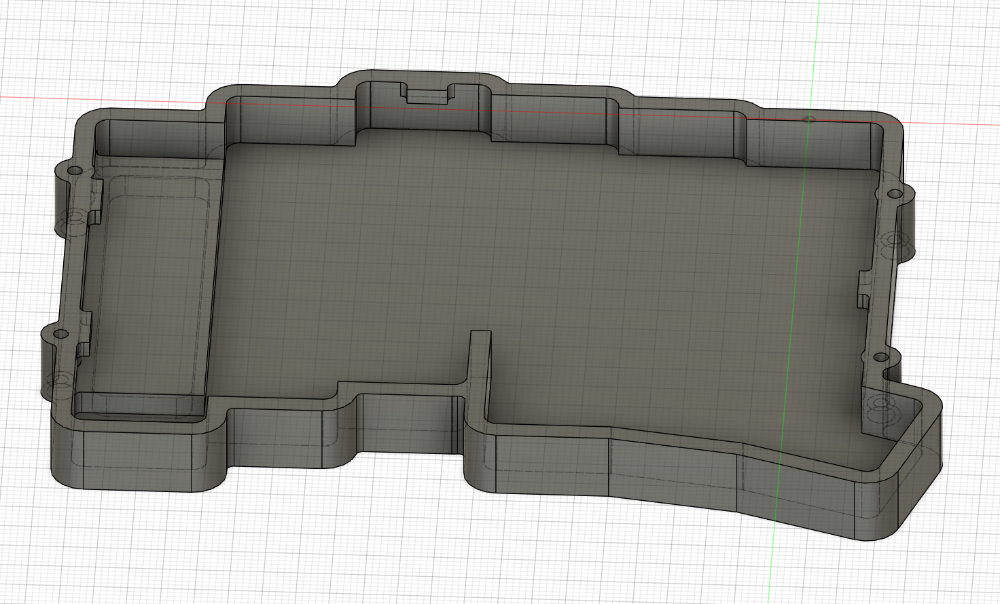

# 左ケース構造試作・CNC角処理・締結の具体化

更新: 2026-11-07。ユーザーの自走指示を受け、旧ケースを使わず公開PCB輪郭から独立した形状を作成した。今回は実体のある左ボトムと上側外周フレームまで作成。スイッチプレートを含む完成トップ、右ケース、加工発注データは未完成。

**後続のユーザー訂正: スタンドは旧bottom_Lの方向に2本。以下の片側1本・Y方向配置は採用しない。** 旧bottom_L v23を読み取りで確認し、長辺X方向のくぼみ2本（各56×14.5 mm、Y方向中心間46.5 mm）を測定した。旧寸法や絶対位置を新ケースへ自動継承せず、本数・方向の要求として反映する。ユーザーの「ちょっと待ってね」に従い形状変更を停止した。既存の配置案Bと左構造v01〜締結v03は、このスタンド配置の修正が必要な比較資料として保持する。

同時に部品情報を受領: COROPITは概寸幅40×奥行25×最大高さ26 mm、固定面から球頂点まで約25 mm。24.95 mmの精度の測定値としては扱わない。XIAOはキー側に実装、v3ビルドガイドでは基板への直付けを確認。旧xiao-nrf52840-v3を開いたが、寸法測定はスタンド訂正への対応のため未実施。

## 現在のCAD

Fusionプロジェクトroba-v3-lp-cnc-caseの02_designに保存。F3D・部品ローカルSTEP・検証JSONはcad/designに保存した。すべて検討用で、cad/exportへの加工用出力は行っていない。

| デザイン | 内容 | クラウド版 |
| --- | --- | --- |
| lp_support_cnc_corners_v02_NOT_FOR_MANUFACTURE | LP支持部6種類に工具逃げと裏ポケットRを追加 | v2 |
| left_case_structure_v01_NOT_FOR_MANUFACTURE | 左ボトム・上側外周・支持・ボスの初期形状 | v2 |
| left_case_structure_cnc_v02_NOT_FOR_MANUFACTURE | 凹角R1、支持逃げ拡大、電池搭載余裕 | v2 |
| left_case_fastening_v03_NOT_FOR_MANUFACTURE | 現在の比較案。ねじ頭の座ぐりとM2パイロット深さを追加 | v3 |

STEPは各部品ローカル座標。組立位置はF3Dを使う。旧ケースの原点・外形・肉厚・ねじ位置・組立変換は継承していない。公開v2 PCB自体の実機版との一致は未確定のため、形状の妥当性はこの前提に依存する。

画像は上側・PCB・電池余裕を一時非表示にしたCADプレビュー。向かって左の高い部分がスタンドくぼみの裏側。表示は出力後に組立状態へ戻して保存した。

## 1. LP支持部のCNC角処理

開口14.0／14.1／14.2 mm、係止部厚さ1.2／1.3 mmの6種類を維持した別設計。各開口の四隅にR0.5の円による工具逃げを付け、裏側18 mm角ポケットの縦角をR1.5にした。

円中心は開口の各角から内側へR/√2ずつ移動する。工具逃げを含む最大幅は`開口 + 2R(1−1/√2)`。14.1開口なら約14.393 mmとなる。15 mmのスイッチ上側外形に対する名目上の片側余白は約0.304 mm（6種類では約0.254〜0.354 mm）。これは平面寸法の比較で、実際のフランジ角形状・公差・係止爪の強度を保証しない。

追加・除去体積を解析式と照合し、Rを0.5→0.6→0.5、中央開口を14.1→14.15→14.1へ変更して、再計算と体積一致を確認した。前の鋭角版も保持。工具径や爪の形状によってRを変更できる。

JLCCNCの[一般設計ガイド](https://jlccnc.com/help/article/cnc-machining-design-guideline)は、内角を大きくする方針と、深さ3 mm以下で最小R0.5が可能との説明を掲載している。今回の浅いLP支持部ではR0.5を比較候補にできるが、個別の加工承認を得たわけではない。係止部の寸法に影響するため、面取り・バリ取りを最終図面で管理する。[特価設計ガイド](https://jlccnc.com/help/article/special-deal-design-guidelines)の条件は特価枠の説明であり、このケース全体の適用可否を認定しない。

## 2. 独立した左ボトムと上側外周

基準は公開U1のXY原点、PCB下面Z=0。底の外面Z=-11.5、上下合わせ面Z=-1、上側外周の仮上端Z=4.5。PCB参照はZ=0〜1.6。

| 部分 | 仮仕様 |
| --- | --- |
| 外側輪郭 | 公開PCB外周を外へ4 mmオフセット。ねじボス部分は局所的に張り出す |
| 内側輪郭 | PCB外周から外へ1 mm。名目側壁厚3 mm |
| 一般部の底 | 厚さ2 mm、内面Z=-9.5 |
| スタンド領域の内部床 | Z=-5.8。一般部より3.7 mm高い |
| スタンド収納 | 56.8×14.8×深さ3.7、R2.2、底面から切削。残肉2 mm |
| 上側 | 外周フレームのみ。スイッチ支持面・キーキャップとの高さは未確定 |
| 現在の包絡 | 約134.44×102.49×高さ16 mm。キーキャップ・足等を含む製品全高ではない |

スタンド裏の高い部分は側壁へつなげた。単に矩形を置くと壁との間に約0.32 mmの細い溝が残るため、この溝を作らない構成に変更した。電池搭載余裕はX=-66〜-34、Y=-51〜-29、Z=-9〜-3.5の32×22×5.5 mm。電池・くぼみのXY分離は配置案Bを維持する。

高さ、オフセット、加工深さなどの履歴・寸法パラメータを持つが、部品原点のZや支持位置等はまだ固定の比較値。全パラメータを変更したときの自動組立追従を保証する設計ではない。

後続の締結案ではボス・穴径20個を名前付きパラメータへ結び付け、通し穴径2.2→2.3→2.2 mmで再計算・解析体積・干渉0件を検証した。名目形状は元に戻して保存している。

## 3. 基板支持と上下の逃げ

基板縁を受ける4か所の支持部を底側へ追加した。支持上端はZ=-0.2で、基板下面との0.2 mmを絶縁材等の検討用として残す。基板の取付穴を使用しないため、旧左で塞がれた穴を利用できると仮定しない。最終的な基板固定は、スイッチ支持との関係を決めてから確定する。

初期検査で支持部が上側外周へ食い込むことを確認し、上側へ逃げを追加して解消した。凹角Rを付ける段階では逃げをさらに広げた。基板縁の銅箔・部品・配線と、支持面積・絶縁・締付時の力はまだ確認が必要。

底側27か所、上側17か所の凹側の縦稜線にR1を追加した。短い上側の逃げや水平稜線など、全稜線を処理したわけではない。深い凹部・細い工具の到達・保持は個別のDFM課題として残す。

## 4. 底面からのM2締結候補

ねじ軸は旧ケースから流用せず、新しいPCB輪郭の直線部分から配置した。XYは(-108.119997,-59)、(-108.119997,-17)、(13.576167,-59)、(13.576167,-17) mm。ボス径6 mm、底側通し穴φ2.2、上側はM2用のφ1.6パイロット。ねじ山の実形状は作らず、最終図面でM2×0.4・有効長等を指示する。

[AccuのM2×12キャップねじ寸法表](https://www.accu.co.uk/metric-cap-head-screws/250402-SSCF-M2-12-A2-R360)から頭径3.8、頭高さ2、ピッチ0.4 mmを寸法比較に使用した。商品そのもの・ねじロック・材質・購入を指定したわけではない。

| 寸法 | 現行候補 mm |
| --- | --- |
| 底側頭座ぐり | φ4.2×深さ2.2 |
| ねじ頭の底面からの沈み | 名目0.2 |
| 首下長さ | 12 |
| 合わせ面から上側へ入る長さ | 名目3.7 |
| パイロット円筒深さ | 4.5 |
| パイロット円筒端までの余裕 | 名目0.8 |
| パイロット端と上面の残肉 | 1 |
| 頭座ぐり外周のボス側壁 | 名目0.9 |

3.7 mmは幾何学的な突出長で、有効なねじ掛かり長さそのものではない。ねじ先端、入口面取り、タップ不完全山、ドリル先端と寸法公差を最終化する必要がある。残肉1 mm・側壁0.9 mmも、締付力・加工時の変形を評価して決定する。位置決め段・ピンはまだ作っていないため、締結だけで精密位置決めまで成立したとは扱わない。

## 5. 検証範囲

- 最新案で、底ケース・上側外周・未実装PCB・電池搭載余裕の4ソリッド間をFusionの干渉解析で検査し、重なり0件。合わせ面の一致は干渉に含めない設定。
- LP試験片6種類の体積とパラメータ変更を検証。頭座ぐりの追加除去体積も解析式と一致。
- スタンドの残肉部で27点の材料内部判定、その上下の空洞18点を検査。名目2 mmの積み上げと整合。
- 頭座ぐり4面をAPIで再測定し、R2.1・深さ2.2を確認。
- 履歴エラーなし、クラウド処理完了。元STEP6点は読み取り専用・v1のまま保持し、ローカルの元ファイルもハッシュ照合。

干渉0件の対象に実装済みソケット、XIAO、USBプラグ、キーキャップ、電池配線、実スタンド、ねじ山は含まれない。特に支持部はPCB下面の一律3 mm予約空間へ入るため、実部品配置との照合が不可欠。今回の検査を実機適合と読み替えない。

検証JSON: [保存・保護・干渉](left-case-development-verification.json)、[残肉と座ぐりの測定](left-case-material-checks.json)。

## 6. 未確認情報と次の実装

XIAOは[Seeed公式](https://wiki.seeedstudio.com/XIAO_BLE/)で21×17.8 mmとオンボードアンテナを確認した。実機の実装面と高さが未確定なので、USBと無線のための開口を推測位置で確定しない。金属で囲う構成を確定する前に、非金属窓・開口と実機通信を検討する。

ユーザーへ確認中なのはXIAOの実装面・高さと、COROPIT本体の最大外形・固定面からボール頂点までの高さ。Tai-Hao THTというキーキャップのシリーズは特定済みだが、最大外形・裏面・着座高さは引き続き必要。

次の実装は、LP支持面とPCBの高さ関係、USB・電源・リセットの操作開口、アンテナ用の非金属領域、基板縁支持の位置、位置決め段、電池固定、スタンドの指掛かりと開閉軌跡。右ケースのCOROPIT周囲は寸法が揃ってから作る。ねじ・表面処理・公差を含む提出図面と、JLCCNC見積用STEPは最後に用意する。

今回の新規作業は未コミット・未push。直前のコミットは5b650e2。
