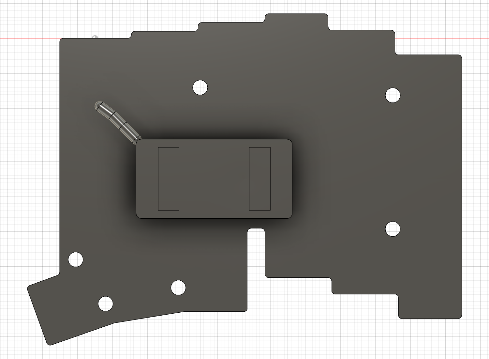

# 左LP実装と電池直付けの再検討

更新: 2026-11-08。開始時はGit `7ee7ac2`・クリーン、Fusionは指定IDのクラウドv22・処理完了・未保存変更なし。新たに開いた `balo43_L` v5も変更せず機械参照に限定した。

**このページはv24までの検討記録。最新は[v25の余長ループと整備姿勢](battery-service-loop.md)。** v24も保存・処理完了・未保存変更なしで終了した。 再起動後にv22の正常保存を確認し、v23で直付け電池の配線検討を反映、v24で確認画像作成後の表示復元を保存した。ケース・PCB・電池受け・Choc等の既存体積と変換は保持。変更前F3Dは `cad/design/checkpoints/v05_cloud_v22_before_direct_solder_battery.f3d`、全体F3Dを更新済み。ケースSTEPは形状不変のため上v22／下v20を維持する。以下のタイムアウトは復旧前の履歴である。

## 左LPの照合

`audit-current-lp-interface.py` の読み取り専用検査で、承認済み構成の変換行列・ボディ数・体積を照合。向き補正済み23組・322ボディ、pin3不在を確認した。

旧PCBの実ソリッドをU1基準へ平行移動し、中央穴23個（D5）とソケット受け46個（D3）を照合。最大中心差0.000001407 mm。322ボディと旧PCB／現行上ケースとの指定立体交差は各0件だった。電気端子はボディ全体の中心ではなく、PCB厚み内の端子部分を切り出して位置を調べる。

旧PCBは厚さ1.51、現行仮PCBは1.6 mmで、実機の版は未確定。汎用Redの第2端子は受け中心から約0.1 mmずれる。これを根拠に穴・スイッチ・ソケットを移動しない。Spring MINIの実寸・公差、爪のたわみ・係止・引抜き操作、実銅箔・はんだ接合は未認定。

v23で再検査し、端子部分をキーのローカル座標へ戻してから中心を評価した。第1端子の最大中心差は約0.000001407 mm、第2端子は約0.1 mm。初回の回転したワールドAABB中心に見られた第1端子約0.02 mmの差は、この測定方法へ更新した。爪の静的なケース交差がないことは、保持力や変形を伴う着脱の認定ではない。

結果は [LP検査JSON](current-lp-interface-audit.json)。[旧PCB円筒面の抽出](legacy-lp-board-hole-geometry.json)は元CADではなく、読み取り結果である。

## 電池の接続条件を更新

ユーザーから今回の対象個体について次を確認した。

- 電池は42×20×5 mm、線40 mm。
- 40 mmの端点はパウチ出口から基板へのはんだ付け位置まで。
- 基板の電池コネクタ用パッドに直接はんだ付けしており、コネクタは付けない。
- 複数台のroBaを所有しているため、他個体のコネクタ仕様を混同しない。

提示された[公開PCBフォルダ](https://github.com/kumamuk-git/roBa/tree/main/pcb)を確認。GitHub APIでmainは既存の固定コミット `69fc34d2996e6aaf63b29f6a58d104b32669f610` と一致した。公開フォルダはv1／v2で、ケース名v3から実機PCB版は確定できない。

保存済み未変更v2 PCBのB1を読み取ると、下面パッド中心はU1基準で以下となる。

| パッド | XY mm | 公開データのネット | サイズ mm |
| --- | --- | --- | --- |
| 1 | −0.38934, −19.341 | Bat | 1×3.5 |
| 2 | −2.38934, −19.341 | Net-(B1--) | 1×3.5 |

電池出口は従来の仮定(−13, −30, −5.6)を保ち、各パッドへの候補経路は約18.579 mm（最後の0.5 mmをPCB下面まで足した比較値）。40との差は約21.421 mm。これは未固定の余りで、曲げ半径・引張り止め・ループ収納・開閉を保証しない。両線の太さも未確定で、D3束／D1分岐は確認用包絡とする。

旧31.08 mm／残り8.92 mmはJSTプラグ経由の履歴で、今回の直付け構成の現行経路には使わない。旧JST本体・プラグ空間は実装部品と数えない。[端点・パッド・経路計算](direct-solder-battery-study.json)を参照。

v23で旧JST・プラグ・配線の3参照に `RETIRED_CONNECTOR_VARIANT_` を付けて非表示退避。電池の実体4個は保持し、確認用グループ内に新配線を追加（6→7個）。新配線は仮D3の束とD1の2分岐で、PCB下面に接する空間予約である。最初のパウチ出口から約1.88 mmは位置仮定の遷移として長さ計算に含め、CAD包絡の開始点はその先に置く。はんだフィレットと引張り止めを再現した部品ではない。

[新配線の形状検査](direct-solder-battery-geometry.json)では336対象を列挙し、正のBBox重複がある6対象の体積交差0件を確認。触れるだけの境界は体積検査から除外。更新した[内部保持検査](internal-retention-fit-verification.json)ではJST本体を実装候補から外した61ソリッド、および新配線・詳細ソケット・既存の確認用空間を検査した。プラグ検査は対象外（非該当）と明記し、空配列を「直付けの着脱が成立」と読み替えない。

図のPCBは機能穴・ランドを省略した輪郭参照。銀色のチューブは配線の予約空間、電池・受けは仮外形で、完成実装の再現ではない。

## ねじと組立の判断

[MISUMIの寸法表](https://us.misumi-ec.com/blog/metric-socket-head-cap-screws-dimensions/)では、六角穴付き円筒頭の最大頭径／高さはM2が3.8／2.0、M1.6が3.0／1.6、二面幅はいずれも1.5 mm。現行M1.6頭包絡D3.2は比較上の保守的寸法として残す。皿頭に替えると座面が変わるため、単なる代替品としない。

M2×12は通し部8.3から公称突出3.7、下穴4.5の底余裕0.8 mm。M1.6×6は通し部3.5から突出2.5、下穴3.2の底余裕0.7 mm。突出量は有効ねじ掛かりではない。[JLCCNCの止まり穴ガイド](https://jlccnc.com/help/article/threaded-hole-guideline)が挙げる穴径半分の非ねじ領域を下穴径で比較すると、余分な余裕はそれぞれ0／0.075 mmしかない。タップの食付き・入口面取り・ねじ端・公差に対して十分とは判断しない。

118°ドリルを仮定すると円筒穴の先にM2は約0.481、M1.6は約0.376 mmの先端深さが必要。平底CADからの軸上残肉はそれぞれ約0.519／0.924 mmになる。これは仮の工具条件による計算で、現行形状へ勝手に円錐を追加したり、薄肉化して穴を深くしたりしない。ねじ・工具・材質と加工先の有効ねじ深さを決める必要がある。

組立移動の全詳細ボディ対検査は300秒でタイムアウトし、完了JSONは得られなかった。読み取り専用だったため設計変更は要求していないが、タイムアウトだけでFusion内処理の終了を断定しない。同じ重い検査を再実行せず、応答と保存状態を確認してから対象を絞る。工具進入・締付順・PCB／カバー着脱の成立は未確認。

その後、ユーザーがFusionの「応答なし」を確認し再起動。MCPは27182ポートへ再接続でき、開いている文書0件から指定v22を開いて保存済み・処理完了・未変更を確認した。復旧後は対象を絞った検査を用いた。実行途中の進捗JSONを残し、境界接触のみの対象は体積演算へ渡さない。これが停止原因だったと断定するものではない。

[限定した工具進入検査](driver-access-verification.json)では、M2の4軸・M1.6の2軸に対して仮の直線円筒D3／D1.8の12条件を検査し、指定対象との交差0件。実工具の柄・保持部・手の空間、正確なキーキャップ、ねじ頭の六角穴は再現していない。締付順候補は「PCB／スイッチを支持した状態でカバー2本を仮締め→交互に着座、電池線を内側へ収めて下ケース4本を仮締め→対角に少量ずつ着座」。実際の締付けトルク・PCB保持・線の噛み込み・連続した着脱動作は未検証。

最終の[保存・構成検査](direct-solder-final-verification.json)で581構成記録、Choc46配置と23ステム上端Z10.2、pin3不在、タイムライン警告0を確認。表示は撮影前へ復元した。`revise-direct-solder-battery.py` は既定が読み取り専用のcheck段階で、applyはv22専用の一回限り処理。現行へ再実行しない。タイムアウトした旧 `audit-fastening-service.py` は実行をブロックし、工具のみは `audit-driver-access.py` を使う。

直付け電池では底ケースとPCBを線がつなぐ。JSTを抜く手順は使えない。小さい開口で底を支持し、線に荷重を掛けず、電池受けを底から解放してPCB側と一緒に扱える候補を検討する。交換にははんだ接続の再作業が伴う。仮経路＋底の下降量の比較では、10 mmで約28.58、15 mmで約33.58、20 mmで約38.58 mmとなるが、柔軟線の成立を検証した数値ではない。

スタンドの実ヒンジ軸・開閉角・脚とゴムの形状、重心と接地安定性は未確定。収納形状・42 mm連続接地辺は維持する。右ケースはこれら左側の前提を整理した後に進める。
