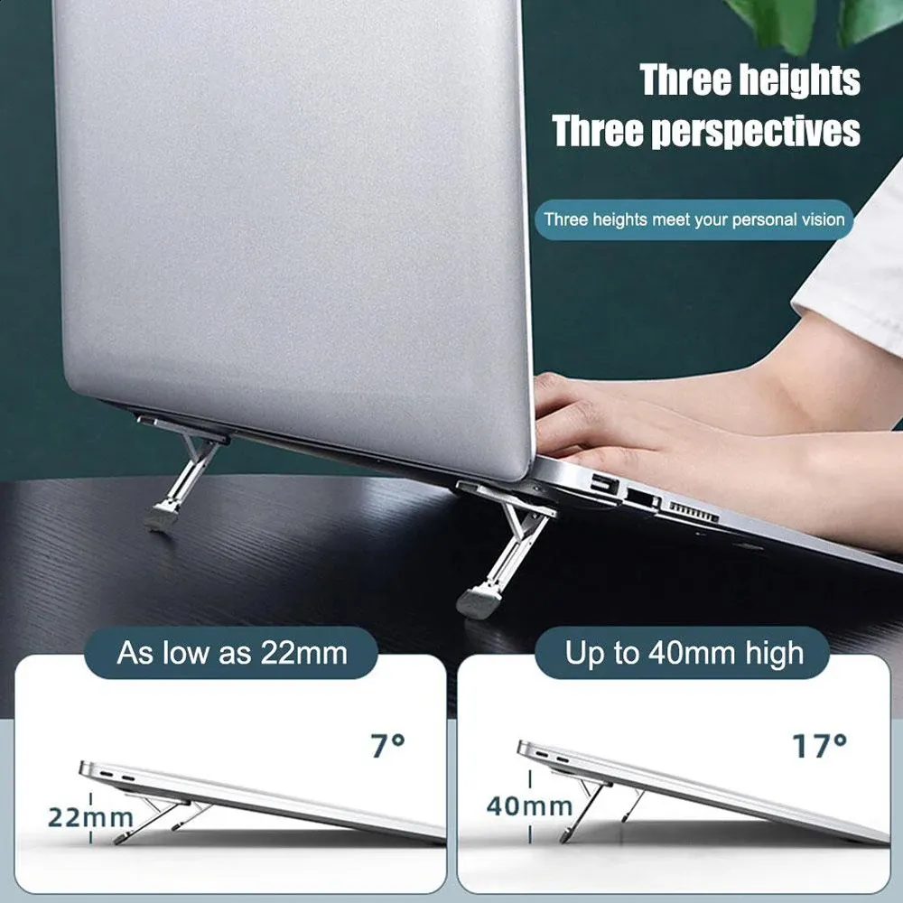

# 購入スタンドの画像・ヒンジ情報の反映

**v29追記:** 右側壁の材料追加に合わせ、ケース単体質量／重心の参照と接地条件計算JSONを更新。上下合計約145.21 g。下記の寸法条件は引き続き仮定で実安定性未認定。

更新: 2026-11-09。Fusionの保存済みv27、587承認構成と一致、未保存変更なしを読み取り確認。形状は変更しない。[前段の仮軸検討](stand-motion-and-stability-review.md)より今回の情報を優先する。

## 根拠と読み取り

ユーザー申告の購入先: [AliExpress製品1005005605228469](https://ja.aliexpress.com/item/1005005605228469.html)。ページは取得できなかったため、ライブの商品仕様を取得済みとは扱わない。ユーザー提供のローカル画像を未加工で保存し、ハッシュを[計算JSON](purchased-stand-conditional-study.json)に記録。

- ヒンジは端から約8.5 mmという現物情報。持ち上げるゴム端と反対のX負側端からと解釈した。端の取り方と軸高さは未確定。
- 画像の表示は3段階、高さ22〜40 mm、ノートPCの例で7°／17°。中間段階の高さは記載されていない。7°／17°をケース角度へ転用しない。
- 22／40 mmの矢印は机に対して鉛直で、ノートPC側の測定箇所も明確でない。貼付面から法線方向に測る実寸と同一と確定できない。
- 既知の概寸56×14.4、最大厚約4.2、付属テープ込み、収納56.8×14.8×深さ3.5は維持。約0.7 mmの収納時突出も未解消の評価事項。

## 今回の条件付き検証

現行収納X−52.5〜4.3に対して長手中央へ56 mm品を置くと端はX−52.1〜3.9。X負側端から8.5なら軸X=−43.6 mm。前段の仮軸X−50.1から6.5 mm移る。56−8.5=47.5 mmを仮可動長に用いるが、実接地点までの回転半径を測った値ではない。

[局所可動包絡](stand-hinge-envelope-verification.json)では47.5×14.4×厚4.2、角R2の仮可動板を使用。全材料が軸より下側、軸後方への張出しなしという条件で、軸Z−8／−10.1／−12.2、2本の位置、0〜90°を5°刻みで計114比較。下ケースとの体積重なり0。これは実ヒンジ・固定ベース・支持片・ゴム形状を含む製品モデルでも、連続軌跡の検証でもない。机への開閉途中の接触・手の進入も未確認。3つの軸Zは感度を見るための仮値で実測範囲ではない。

画像の22／40 mmを、仮に収納の貼付面Z−8から先端接地までの法線高さと解釈した[接地条件比較](purchased-stand-conditional-study.json)では、ケース角度は22 mmで約9.42〜9.58°、40 mmで約20.29〜21.40°。実際の高さ基準が異なれば変わるため、製品のケース搭載角度として採用しない。点接触／幅14.4の比較とも23キー中10中心が仮支持多角形の外側。実機の不安定判定ではなく、全体重心・実ゴム接触と押下力の比較が引き続き必要という結果。

## 設計判断と次工程

今回の条件内では収納の移動・拡張が必要な根拠は得られず、現行形状は維持する。実物の軸高さ、支持片の張出し、各段階の貼付面〜接地面寸法、接触幅を確認するまでは製品全体の運動・転倒安定性を認定しない。実測が必要な範囲以外は、ねじ・組立、電池線の2本別経路と結束方法、COROPIT参照調査を並行して進められる。

Fusion形状は変更していないため、新しいクラウド版・F3D／STEPは作らない。現行はv27のまま。今回更新した根拠・条件付き検査・主JSON・引き継ぎ文書をコミットする。発注用ではない。
