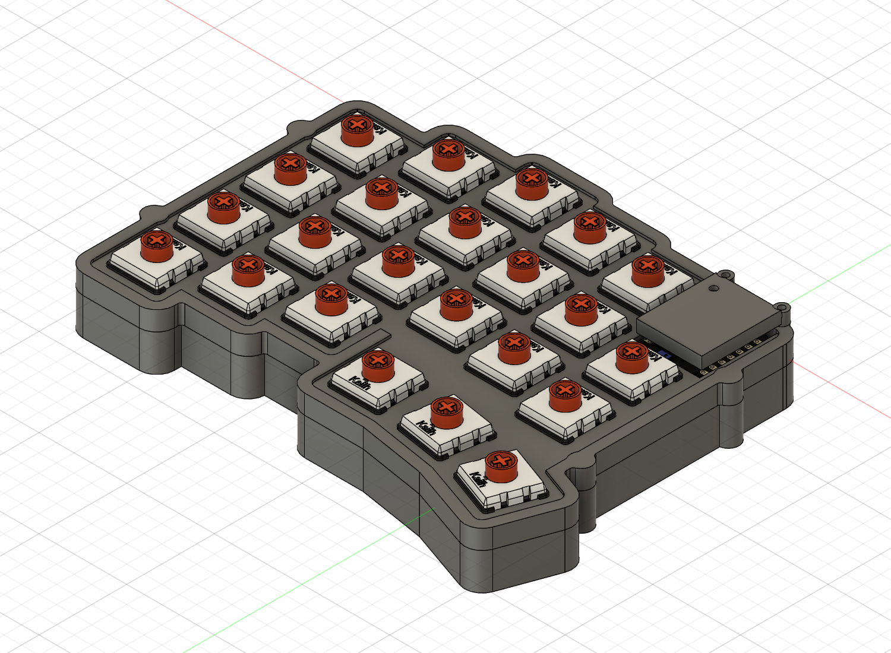
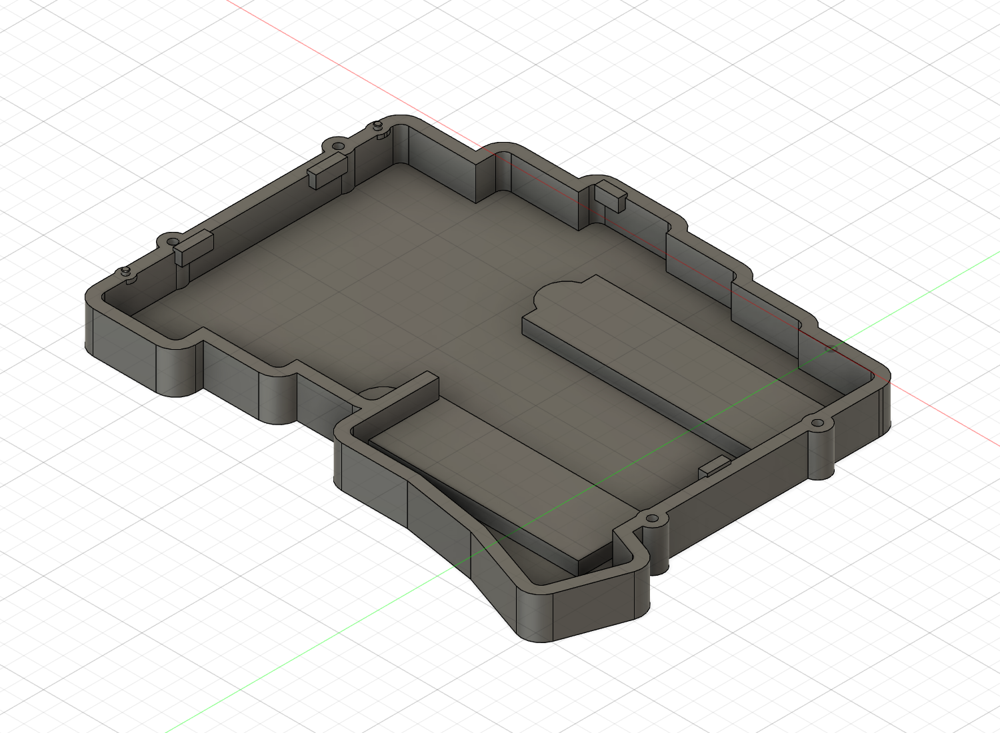

# リセット操作と上下ケースの位置決め

更新: 2026-11-08。この資料はクラウドv10のリセット・位置決めの記録。現在は[内部保持とスタンド深さを更新したv12](internal-retention-development.md)へ進んでいる。リセットと位置決めの寸法は維持。コミットb23f2e9はv9までで、以降の追加分は未コミット・未push。

参照スイッチ: © koktoh、CC BY-NC-SA 4.0。[第三者素材表記](../THIRD_PARTY_NOTICES.md)。ケースの材質・外観は仮表示。

## リセット操作

詳細XIAOの`SKTAAAE010 v1/Body`から、上面中心X=−5.71539、Y=−1.87654、上端Z=3.58000 mmを読み取った。カバー屋根Z=7.5〜8.7に、この中心を通る直径2 mmの仮操作穴を追加。カバーを外さずに非導電ピンを上から入れる方式の比較案とする。押し棒を常設したり、ボタンを押した状態で固定したりする構造にはしていない。

[Alps AlpineのSKTAAAE010公式仕様](https://tech.alpsalpine.com/e/products/detail/SKTAAAE010/)は上押し、ストローク0.11 mm、製品高さ0.53 mm。旧モデルではモジュールPCB上面Z=2.85から上端3.58まで0.73 mmあり、公式公称高さとは0.20 mmの差がある。元データは変更せず、旧モデルと実機の部品版・実装高さの照合が必要な事項として記録。押込み深さのストッパーは設計していない。

直径0.8 mmの仮工具をボタン上端から0.01 mm上〜Z=16へ置くと、カバー・ケース・詳細MCUとの体積干渉はない。ボタン上端より0.11 mm下まで伸ばす区間を外接範囲で検査すると、該当する詳細部品は対象ボタン本体だけだった。これは経路の幾何確認で、実際の接点動作・指の操作・押圧力・工具の許容傾きの試験ではない。

## 上下の位置決め

ねじを締める前に上下のXY位置を合わせるため、左側外周に一体の突起を2個追加した。基板の穴を使わず、M2ねじ穴から離して設けている。

| 項目 | 仮寸法 mm |
| --- | --- |
| 中心 | (−107.12, −72)、(−107.12, −8)、間隔64 |
| 下側の突起 | 直径1.6、高さ1、Z=−1〜0 |
| 突起先端 | C0.15、先端直径1.3 |
| 上側の丸受け | 直径2、深さ1.2、Z=−1〜0.2 |
| 上側の長穴受け | 幅2×長さ2.6、長手Y、同じ深さ |
| 公称余裕 | 突起胴と受けの半径差0.2、先端と穴底の差0.2 |
| 補強座 | 丸外径4、長穴側の外形4×4.6 |
| 補強の高さ | 下側Z=−2〜−1、上側Z=−1〜1.5 |

丸受けを基準とし、もう一方の長穴で中心間方向の余裕を持たせる。仮寸法の半径差0.2は位置精度を保証する値ではない。加工公差・アルマイト・試作結果に応じて見直す。

元の外周壁だけに受けを切ると、局所の壁が約0.5 mmになるため、丸／長穴形の補強座を追加した。受けの周囲は名目1 mmの肉を残す。外形には局所的な約0.5 mmの張り出し・段ができるので、外観、工具到達と加工コストはDFM確認項目。補強後に受けを同じ寸法で切り直し、突起の進入空間を維持した。

PCB支持上端は引き続きZ=−0.2。下ケース全体の最高点Z=0は位置決め突起であり、支持高さとして読み取らない。

## 組立・整備の考え方

仮の組立順は、上側へスイッチを取り付け、下からPCB・ソケットを合わせ、上側とPCBを一体の組立として下ケースへ載せる。位置決め突起を合わせてから底側のM2ねじを締める。電池・配線の固定と余長、基板縁の絶縁材はまだ具体化していない。

スイッチのフランジは開口より大きいため、上側だけを完成済みスイッチ群の上へ通せるとは扱わない。整備時はPCBと上側の関係を保ったまま下ケースを外す手順を検討する。仮手順であり、実物の挿抜力・工具の進入・作業性は未検証。

リセットは操作穴から、MCUの整備は前側の小ねじ2本を外してカバーを上へ取り外す方針。カバー後部の剛性・樹脂材質、実ねじ頭、アンテナ性能は未確定。

## 検証と保存

- ケース等の52ソリッド、詳細Choc V2・ソケット、詳細MCU、仮キーキャップ押下包絡、USB空間を目的ごとに検査し、ケースとの体積干渉0件。
- リセット仮工具もケース・詳細MCUに対して体積干渉0件。旧MCU内部の12件は分けて記録。
- Chocの全46配置原点が再計算後も維持されることを確認。
- 受け周囲48点、補強の外側8点、突起2本の先端面取りを確認。部品3点とも単一ソリッド、履歴エラー・警告0件。
- 既存M2パイロット深さ4.5 mmは変更していない。固定用の有効ねじ長・締付強度を新たに認定したものではない。

寸法と検査は[設計JSON](service-and-locating-development.json)、[最終検証JSON](service-and-locating-verification.json)。変更前v9のF3Dはcad/design/checkpointsに保持。元の参照6点と旧XIAOは未変更。加工用cad/exportは引き続き未作成。

次は、PCB縁の絶縁・電池と配線の保持、カバー後部の支持と材質、スタンドの仮開閉軌跡・接地を具体化する。その後に右COROPITケースへ進む。
