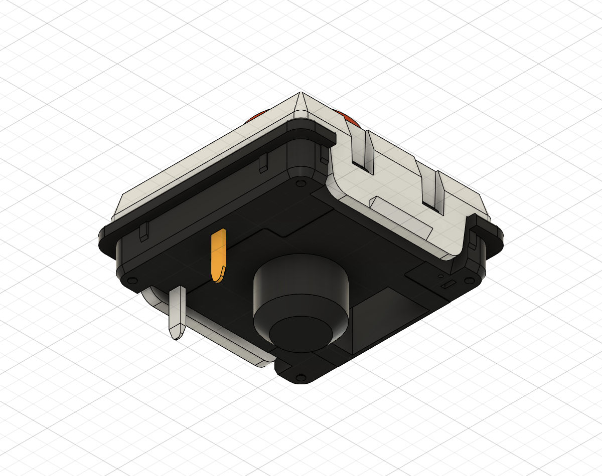

# Spring MINI向け参照から補助固定ピンを除外（v21）

更新: 2026-11-08。選択された面は汎用ChocV2 Redの `pin3` に属していました。ユーザーの現物に見当たらないとの指摘を受け、Webの製品写真とメーカー資料を調べたうえで、現行のSpring MINI用派生参照から除外しました。クラウドv21、保存・処理完了・未保存変更なし。

## 調査結果と判断の根拠

- [Kailhの2020年Choc V2説明](https://www.kailhswitch.com/info/kailh-choc-v2-feature-44841625.html)にはmovable fix pinの記載があり、[固定ピンのメーカー図](https://www.kailhswitch.com/Content/uploads/2020306614/202004151434063ad9b783356b42e8b363d933630e9d07.jpg)には電気端子とは反対側の補助ピンが描かれています。現在の作者Redモデルの `pin3` はこの形・位置に相当します。
- 購入先の[TALP Spring MINI商品ページ](https://shop.talpkeyboard.com/products/kailh-spring-mini-chocv2)と、その[裏面が見える製品写真](https://shop.talpkeyboard.com/cdn/shop/files/2025-05-1522.10.58.png?v=1747314687)を確認。写っている個体には2本の金属端子と中央樹脂柱があり、該当する反対隅の金属補助ピンは見当たりません。
- [遊舎工房の同商品](https://shop.yushakobo.jp/products/18433)には3pin表記もあります。この表記だけから金属端子が3本あるとは判断せず、裏面写真で部位を区別しました。

以上とユーザーの現物観察を根拠に、今回の対象の参照モデルからは不要と判断しました。すべてのChoc V2や全製造ロットに補助ピンがないと断定するものではありません。Spring MINI専用の完全なメーカーCAD／寸法図は未取得で、残る形状まで厳密に一致したとは扱いません。

## CADでの処理

元STEPを編集せず、現行文書に取り込んだ共有redコンポーネントへ履歴付きRemoveを追加し、全23インスタンスからpin3を除外しました。非表示だけではないため、通常の組立部品を列挙する干渉検査にも入りません。原形は元STEP・v20クラウド履歴・`cad/design/checkpoints/v05_cloud_v20_before_spring_mini_fix_pin_removal.f3d` に残ります。

派生部品名は `CHOC_V2_RED_DETAILED_DERIVED_SPRING_MINI_NO_FIX_PIN`。元作者の未変更部品とは区別します。単一スイッチのボディ8→7、23個のスイッチ計184→161。ソケット161は維持し、詳細Choc全体は345→322ボディです。電気端子pin1・pin2は各23個、ステム23個を保持。残存する部品の体積・配置・表示は変更前と照合し、ケース・電池受けも変更していません。実物スイッチを切断する指示ではありません。

画像は汎用Redを基にした派生参照で、Spring MINI実品の色や完全な内部構造を再現したものではありません。

## 再検証と保存

46原点・23ステム上端を再計算後に確認。詳細スイッチ／ソケット対ケース・カバー、主要62ソリッド、ソケット・支持絶縁材・配線等の指定検査を実施し、外部への重複0件。部品内部の92重なりは別扱い。元の第三者STEP等は保存バイトのSHA256一致を確認しました。

全体F3Dと主JSON・参照階層・承認済み状態を更新。ケース形状不変なので上下ケースのSTEPはv20形状を維持しています。今後の配置スクリプトは派生7ボディと元の8ボディを区別します。残る2端子・中央柱・爪と、実機PCBの穴／ランド・公差・組立の確認は未完了です。

[変更と出典JSON](spring-mini-fix-pin-removal.json)、[現行配置](choc-v2-placement-verification.json)、[指定部品の検査](detailed-choc-fit-verification.json)。
