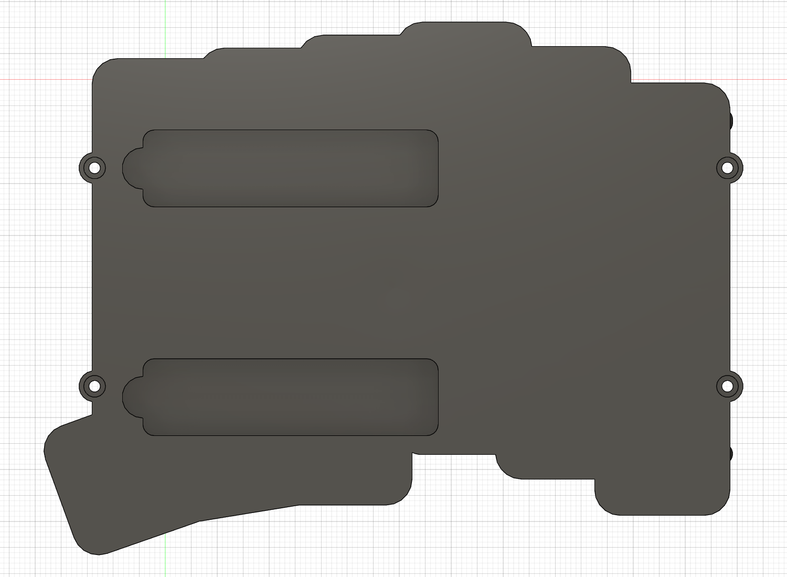

# スタンド裏当て・M2穴の修正（v18）

更新: 2026-11-08。`left_case_two_stands_v05_NOT_FOR_MANUFACTURE` のクラウドv18へ保存し、処理完了・未保存変更なしを確認。[v17で発見した2件](v17-fastening-and-overhang-audit.md)を修正しました。全体の製造・締結成立を認定したものではありません。未コミットです。

## 修正内容

裏当てを外周で単純に切り落とすのではなく、2本の収納・裏当て・D8指掛かり・D12補強を一緒にX−方向へ2.5 mm移動。外周に近かった1本だけY＋方向へ2.5 mm移動しました。寸法とX正側の指掛かり方向は維持。元のM2穴を加工した後の追加材が穴へ入らない配置となり、既存の穴形状が再計算で復元されました。穴を拡大したり、ねじ位置を変更したりしていません。

| 項目 | 修正後 |
| --- | --- |
| 収納1 XY始点 | (−52.5,−68.5) mm |
| 収納2 XY始点 | (−52.5,−24.5) mm |
| 両収納の寸法 | 56.8×14.8、R2.2、深さ3.5 mm |
| 指掛かり中心 | (4.3,−61.1)、(4.3,−17.1) mm |
| 指掛かり／裏当て径 | D8／D12、残肉2 mm |
| 裏当てと底面外周の最小平面距離 | 収納1約1.229、収納2約3.776 mm |
| 裏当てと最寄りM2頭座の最小平面距離 | 収納1約1.411、収納2約1.177 mm |

下ケース以外の部品の体積、全コンポーネントの変換行列、表示設定は変更前と照合して維持。下ケース体積は35834.8611→35946.4942 mm³です。旧グループ、電池グループ、局所試験片は維持。試験片は収納の局所形状が同じため再作成していません。元参照データは未変更です。

底面からの表示はXYの見え方が反転しますが、設計座標での指掛かりはX正側です。

## 検証した範囲

1. **M2穴全4箇所**: D2.2通路・D4.2頭座・上側D1.6パイロットの名目空間と材料の重複が0。仮のM2×12（軸D2、頭D3.8×高さ2）と下ケースの衝突も全4箇所で0。上側のねじ外径対タップ下穴の意図した重なりは別扱いです。
2. **収納と残肉**: 各収納の角Rを含む名目立体とD8指掛かりの和を作成。深さ3.5 mmの空間へ入る不要材料が0 mm³、直上2 mmの残肉に欠ける材料が0 mm³であることを立体ブーリアン比較で確認。数点のサンプルだけで残肉全体を推定していません。
3. **M2頭座周囲**: 全4箇所で外径D6と座ぐりD4.2の間の半径方向0.9 mmの環状材料に欠損0。これは形状の確認であり、0.9 mmを強度・加工上十分と認定した値ではありません。
4. **裏当て全体の外形**: 実際に移動したスケッチの矩形＋D12円の全投影を、元の底面プロファイルと比較。外へ出る面積0 mm²。底面曲線の弦近似誤差上限0.0001 mm、円の弦誤差上限約0.0000071 mmで計算し、1 mm以上の距離を確認しています。これはケース全体の全突起を一括で否定する検査ではありません。
5. **周辺部品**: 主要62ソリッド、配線D3包絡、仮プラグ・粘着タブ・余長空間、詳細ソケットとの指定組み合わせの干渉0件。電池42×20×5 mm・線40 mmの配置は維持。B1下の名目差0.5 mmも保持。タイムライン警告0件。

[修正記録](stand-and-M2-correction.json)、[M2通路・ねじ検査](fastening-and-overhang-current-audit.json)、[空隙・残肉の立体検査](corrected-stand-solid-verification.json)、[全裏当ての投影検査](corrected-stand-footprint-verification.json)、[指定部品間の干渉検査](internal-retention-fit-verification.json)。

## 保存と残る制限

修正前は `cad/design/checkpoints/v05_cloud_v17_before_stand_and_M2_correction.f3d` に退避。現行全体F3Dと下ケースの単一ソリッドSTEPを更新しました。他のSTEPは形状不変です。

ねじ山、タップ食付き、穴先端・公差、締結強度、ドライバー到達、加工費・工具条件、実物のスタンド開閉・接地と組立は未認定です。位置決め座の記録済みの局所張り出しも今回の2件と区別して保持しています。「今回の不適合2件を修正し、列挙した検査を通過」と扱い、設計全体が無条件に干渉なし・発注可能とは扱いません。
