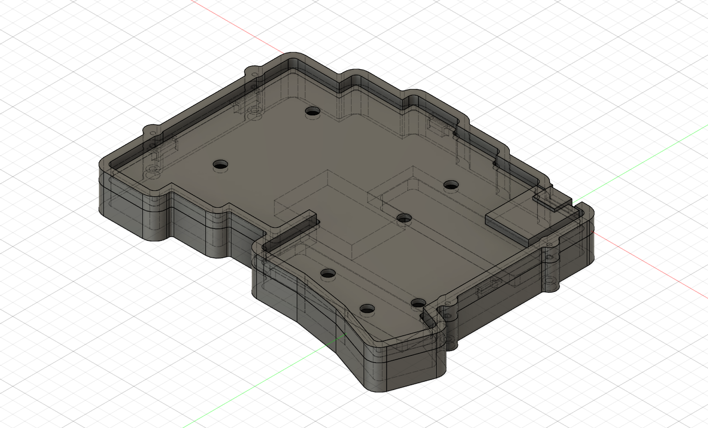

# 横向き2本の現行v05とXIAO包絡

更新: 2026-11-07。現行はFusion `02_design/left_case_two_stands_v05_NOT_FOR_MANUFACTURE`、クラウドv2。新しいファイルを増やさず同じデザインを更新した。旧試作はoldに保持している。完成ケース・発注用ではない。

## 今回反映した形状

- スタンド収納は長辺X方向に2本。各56.8×14.8×深さ3.7 mm、角R2.2。左PCBのU1基準でX=-50〜6.8、Y=-71〜-56.2／-24.5〜-9.7 mm。前後中心間46.5 mmは比較値。旧ケースの絶対座標をコピーしたものではない。
- くぼみ裏の残肉は名目2 mm。2本の間に、電池搭載余裕32×22×5.5 mmをX=-66〜-34、Y=-51〜-29、Z=-9〜-3.5へ置いた。高い裏当てとのY方向の最小間隔は2.5 mm、収納くぼみとの間隔は4.5 mm。配線・固定材・実物の膨らみ等は別途確認する。
- 凹側の縦稜線にR1: 底側30か所、上側17か所。上側の支持逃げも拡大した。CNCの全内角・加工方向を最終化したわけではない。
- M2候補は底側の頭座ぐりφ4.2×深さ2.2、上側のパイロットφ1.6×円筒深さ4.5 mm。旧締結案の首下12 mm候補を踏襲する比較であり、有効ねじ掛かり・材質・締付トルクは未確定。
- 切削対象をparticipantBodiesで指定し、上側の逃げが下側支持へ作用しない構成にした。支持上端Z=-0.2を再確認した。旧試作の一律の干渉0件だけでは支持高さを保証できないため、寸法検査も追加した。

## XIAOの単体3Dから得た値

旧プロジェクトのxiao-nrf52840-v3 v2は未変更のまま読み取り測定した。77ボディを含むモデルで、元座標はXが長さ、Yが厚さ、Zが幅。

| 測定項目 | mm |
| --- | --- |
| PCB本体 | 長さ20.955×幅17.78×厚さ1.25 |
| PCB本体の元座標範囲 | X -8.67334〜12.28166、Y -0.25〜1、Z -15.0014〜2.7786 |
| モジュール全体の厚さ | 4.46（元Y -0.25〜4.21） |
| USBを含む長さの包絡 | 約22.482 |
| USBボディの元座標範囲 | X 6.50864〜13.80864、Y 0.01〜4.21、Z -10.58873〜-1.64873 |

ユーザー申告のキー側直付けを前提に、モジュール下面を公開PCB上面Z=1.6へ置くと最高部はZ=6.06。はんだの間隔、実機版、取得元の版は未照合であり、精密な実装高さの確定値ではない。

元モデルの形状や旧組立変換はそのまま使わず、測定値から保守的な2ブロック包絡を作った。主部はX±8.89、Y=-20.955〜0、Z=1.6〜4.87、USB部はX=-4.47733〜4.46267、Y=-5.77302〜1.52698、Z=1.86〜6.06。両ブロックを結合した単一ソリッドとして配置した。

## USBアクセス

上側外周に、X=-6〜6、Y=0〜18、Z=1〜7 mmの仮アクセス空間で切欠きを追加した。現状の外周上端はZ=4.5のため、閉じたコネクタ穴ではなく上に開いた切欠きになる。実際のプラグ外形・ケーブル曲げ・抜き差し方向は未照合。これをアンテナ窓や通信確認の代わりにはしない。

## 検証

底、上側外周、未実装PCB、電池搭載余裕、XIAO包絡の5ソリッドをFusionの干渉解析で確認し、重なり0件。接している面は干渉に含めない設定。履歴エラーなし・クラウド処理完了・保存後未変更を確認した。2本の残肉内部で計18点、支持部の最高Z、くぼみの切削体積も検証した。[API検証JSON](two-stand-case-verification.json)を参照。

スイッチ・ソケット・キーキャップ・配線・実スタンドの展開包絡・ねじ山は対象外。特にPCB縁支持は実部品と銅箔の照合が残る。指掛かり、開く向き、接地の安定性、電池固定、上下の位置決め、スイッチプレートと上縁高さ、電源・リセット操作部、RF用非金属領域、右COROPIT周辺は未完成。

ローカルはcad/designに同名F3D・上下部品別STEP・JSON。STEPは部品ローカル座標で、組立位置はF3Dを見る。今回分は未コミット・未push。
