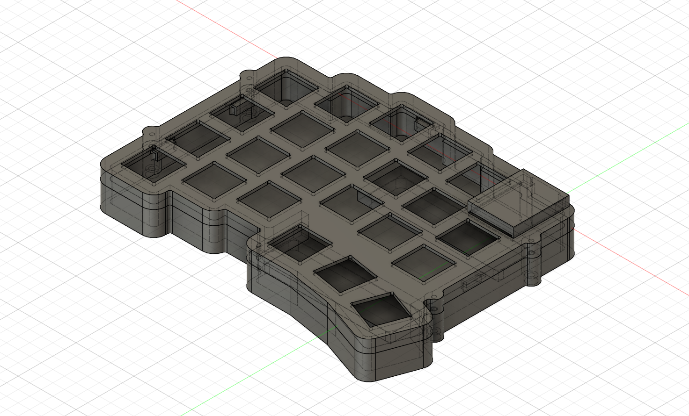

# 保護天板とLP開口・XIAOカバー候補

更新: 2026-11-07。現行`left_case_two_stands_v05_NOT_FOR_MANUFACTURE`を同じクラウドファイルのv5へ更新した。進捗整理時に表示状態を保存しv6となったが、検証済み形状は同一。上側は外周だけの輪ではなく、キー間と基板外周を覆う天板を持つ単一ソリッドになった。完成・発注用の設計ではない。

## 上側の形状

コンポーネント名を`Upper_L_PROTECTIVE_ROOF_23_LP_OPENINGS_PROVISIONAL`へ変更した。

- 公開PCB外周を1.8 mm外へオフセットした天板を、既存外周フレームへ結合。屋根とフレームは1ソリッド。
- 天板上面Z=4.5、下面Z=3.3、厚さ1.2 mm。薄い天板全体でLP係止部の厚さを試す構成であり、現物の爪保持や剛性を確認した値ではない。
- 公開PCBのφ5穴中心と各スイッチ回転角から、14.1 mm角のキー開口を23か所作成。親指キーの回転も反映した。
- 四隅にはR0.5の工具逃げ。23か所の角穴と92か所の工具逃げの除去体積を解析式で照合した。
- XIAO用の開口はX=-9.5〜9.5、Y=-21.1〜2.6 mm。USB切欠きを維持し、別体カバーで上方を保護する構成。

天板を作る際はいったん別ボディで生成し、キー穴・XIAO開口を加工してから上側だけへ結合した。一時的に交差するXIAO参照を結合・切削に巻き込まないためで、参照モデルや底側は変更していない。底側体積35980.319110 mm³は前回と一致する。

## キーキャップの公式寸法

[Tai-Hao公式black商品ページ](https://shop.tai-hao.com/products/black)の説明画像を直接取得して確認できた。以前は取得できず未確定としていたが、今回次を読めた。

- [商品仕様画像](https://img.shoplineapp.com/media/image_clips/66fa33c70f9cc8000cfe0edc/original.jpg): THT、18.1×18.1 mm、Choc V1／MX仕様。
- [プロファイル比較画像](https://img.shoplineapp.com/media/image_clips/65eac958b1596d00172bf079/original.jpg): THT高さ3.94 mm。

画像は寸法の読み取りに使用し、リポジトリには転載していない。商品単体高さをPCBからの高さとして加算していない。軸への挿入深さ、下面の形状、押下時の最低位置は依然として未確定。

## 別体の非金属カバー候補

`MCU_NONMETAL_COVER_CONCEPT_RETENTION_PENDING`を追加。材料と製法は未選定で、保持爪やねじもまだない。現状は配置を検討するカバー形状であり、固定・脱落対策が完了した部品ではない。

外側はX±9.9、Y=-20.95〜3、Z=4.5〜8.7 mm。天板厚1.2、側壁厚0.8 mm。後壁の下端をZ=5.2へ上げ、XIAO主部との接触を避けた。後側下部には隙間が残るため、密閉構造ではない。前側にはUSB用の12 mm幅の切欠きを設けた。非金属候補としたのはアンテナ上方を金属で塞がない構成を検討するためで、通信性能を確認したわけではない。

THT外形18.1角に、設計上の横余裕0.35 mmを各側へ足した18.8角の回転包絡を使い、23キーすべてがカバーの平面範囲と重ならないことを確認した。最小間隔はSW17側で約0.119 mmと小さい。0.35 mmはスイッチの横変位仕様を参考に置いた仮定で、キャップ全体の変位や加工公差を保証する値ではない。この隙間で採用確定せず、実形状・着座高さ・製作誤差を踏まえてカバー形状を詰める。

## 検証済みと未確認

検証済み:

- 上側とカバーは各1ソリッド。キー開口中心23点が空洞、両側の係止部46点が材料内部であることをAPIで確認。
- 14 mm角のスイッチ最大ハウジング仮包絡を23個配置。爪、端子、フランジ、キーキャップの3Dではない。
- 底、上、PCB、電池余裕、XIAO包絡、カバー、スイッチ包絡の計29ソリッド間で体積干渉0件。接する面は干渉として扱わない設定。
- USB用の仮アクセス体積12×18×6 mmは、上側・カバーに対して干渉0件。この体積はUSB本体と意図的に重なるため、上記の29ソリッド検査から分離。
- 履歴エラーなし、クラウドv5処理完了。外形・開口・包絡の検証は[JSON](upper-roof-verification.json)とcad/design/upper-roof-development.jsonへ保存。

次に確認すること:

1. Spring Miniの実際の着座高さ、爪の掛かりとたわみ、スイッチの抜き差し、THT押下時の天板との上下隙間。
2. XIAOカバーの固定、狭いキー間隙間、製法に応じた肉厚、USBプラグの実物とケーブル、無線通信。
3. スタンドの指掛かり・展開軌跡・接地、PCB縁支持と銅箔、電池固定、上下の位置決め、右COROPITケース。

CAD表示ではケース・カバーを表示し、PCBや包絡は非表示にした。参照はコンポーネントの表示をONにすれば確認できる。現行F3Dと`Upper_L_protective_roof_LOCAL.step`、`MCU_cover_concept_LOCAL.step`をcad/designに保存。以前の同名v05の外周だけのSTEPはcheckpointsへ移動した。変更前のF3Dもcheckpointsに保持している。

本記録と成果物はGitで管理する。pushは未実施。参照STEPと旧プロジェクトは未変更。
