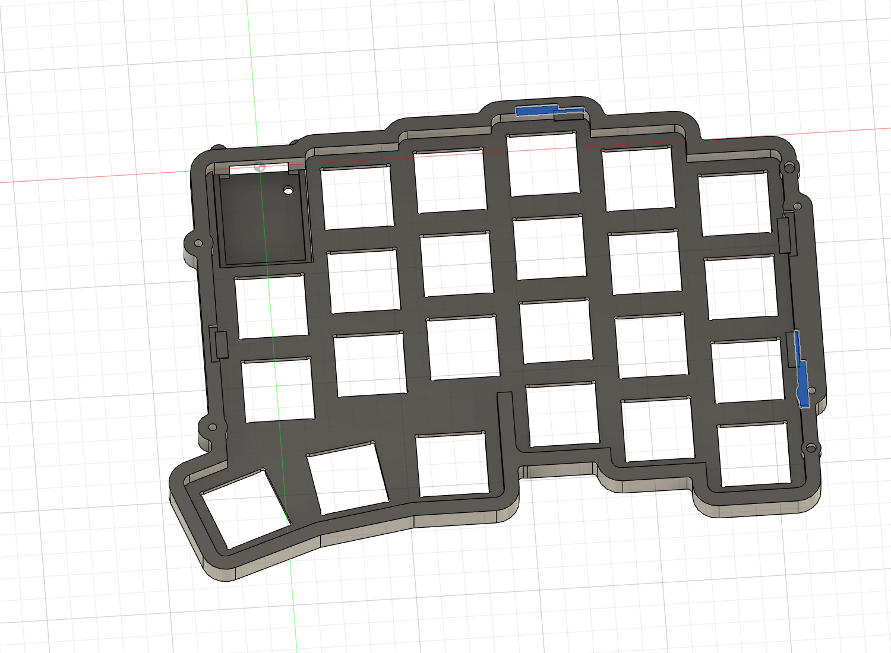
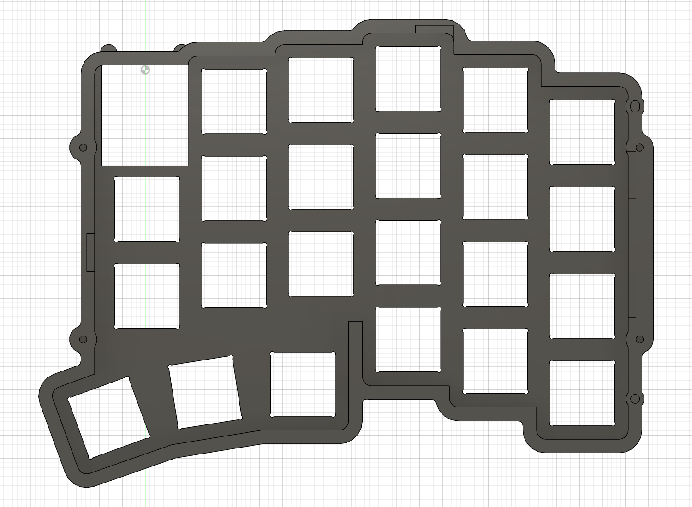

# 上ケースの支持逃げ更新漏れを修正（v22）

更新: 2026-11-08。選択された2面はpin3ではなく、上ケースのPCB支持用逃げ面でした。表示のキャッシュや旧コンポーネントではなく、現行上ケースの更新漏れです。クラウドv22へ保存し、処理完了・未保存変更なしを確認しました。

## 原因と修正

支持1をY＋8 mm移動したとき、小さい0.2 mm逃げだけを移し、1.2 mmの拡張逃げが旧位置に残っていました。また、以前支持4をX−方向へ6.3 mm移動した際、後段で0.2 mm逃げを追加しただけで、元の小さい逃げと拡張逃げを旧位置に残していました。不要な切欠きは部品同士の重複検査では見つからないため、支持位置と加工フィーチャーの関連も検査する必要がありました。

- `Expanded_support_clearance_1` を支持1と同じY＋8 mmへ移動。
- `Support_clearance_4_0p2mm` と `Expanded_support_clearance_4` を支持4と同じX−6.3 mmへ移動。
- 後段の重複 `Relocated_support_4_upper_relief_0p2mm` を履歴内で抑制。元に戻せるよう削除はしていません。

上ケースだけを変更し、他の形状・配置・表示は保持。上ケース体積13564.5301→13573.5249 mm³。旧位置に不要に削っていた材料は復元されました。

## 検証

現在の4支持位置に対し、通常逃げ0.2 mmと拡張逃げ1.2 mmの計8フィーチャーのXY矩形を照合し一致。各支持の周囲0.2 mm・組立Z−1〜0の名目空間と上ケースの体積重複は4箇所とも0。旧不要切欠き位置の材料復元もサンプル点で確認。

向き補正済みの詳細Choc／ソケット、主要62ソリッド・支持絶縁材・配線等の指定検査、M2全4箇所の穴・頭座・名目ねじを再検査して通過しました。pin3の除外は維持、タイムライン警告0件。形状整合の確認であり、加工性・公差・実物組立の認定ではありません。

全体F3D、上ケースの単一ソリッドSTEP、主JSONと承認済み構成を更新。他の部品STEPは形状不変。変更前は `cad/design/checkpoints/v05_cloud_v21_before_upper_support_relief_alignment.f3d` に退避。元参照データは未変更です。

[変更記録](upper-support-relief-alignment.json)、[8逃げ／4支持の検査](upper-support-relief-verification.json)。今後支持を動かした場合は、通常逃げ・拡張逃げ・絶縁材・後段の追加加工を一緒に確認し、`verify-upper-support-relief-alignment.py` を読み取り専用で実行してください。
