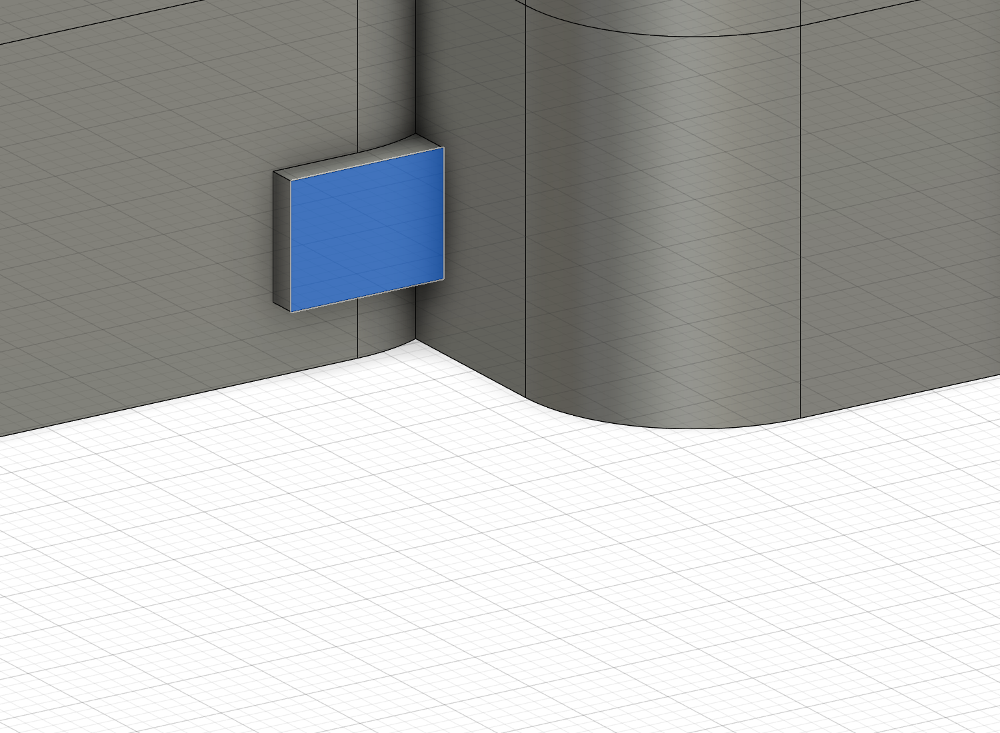

# v17 固定穴・外周張り出しの監査

2026-11-08追記: この監査の2件はクラウドv18で修正済み。[修正内容と検証範囲](stand-and-M2-correction.md)を参照。v17の不合格記録は履歴として保持します。

更新: 2026-11-08。ユーザーが選択した面とねじ穴をFusion MCP/APIで読み取り点検。**結果は不合格。v17を「干渉なしの設計」と扱ってはいけません。** 今回は形状・表示・選択・クラウド保存を変更していません。現在の文書の未保存フラグは調査開始時から存在しており、調査前のユーザー操作を上書きしていません。

## 新たに確認した見落とし

| 指摘 | 実測・判定 | 状態 |
| --- | --- | --- |
| スタンド裏当ての外周張り出し | 選択面は下ケース、X−52〜−47.47、Y−73、Z−9.5〜−6 mm、面積15.855 mm²。6箇所の測定断面で底面外周より約0.854〜1.258 mm外へ出る | 未記録の外形不整合。意図した外観とは判断しない |
| M2固定穴1箇所の閉塞 | 軸X13.576167・Y−17。D2.2通し穴へ約1.06527 mm³、D4.2座ぐりへ約0.67260 mm³の材料が残る | 修正必須 |
| 同じ穴でのねじとの衝突 | 仮M2×12、軸D2、頭D3.8×高さ2で、軸と下ケースの重なり0.59154 mm³、頭と下ケース0.50762 mm³ | 名目ねじでも不成立 |

原因の特定: スタンド指掛かりをX正側へ反転した際、そのD12裏当ての追加材が、先に加工したM2穴・頭座へ入った。穴を後から再確保する検査を設けておらず、単体ソリッドの中で起きた穴の埋まりを検出できなかった。選択面は矩形裏当ての追加材が底面輪郭の外へ出たもので、従来の検査は裏当てと底面の投影外形を比較していなかった。これらを「後で直すと把握していた形状」と説明するのは正しくなく、設計・検証の見落としとして記録する。

## 別に把握していた未確定事項

- 上下の位置決め座には局所的な約0.5 mmの張り出し・段があり、[位置決めの記録](service-and-locating-development.md)に外観・工具到達・DFM項目として記載済み。今回の矩形裏当ての張り出しとは別件。
- M2頭座の名目半径方向の肉は0.9 mm、上側の穴底残肉は1 mm。設計比較値で、強度・加工性を認定していない。
- M1.6ねじ、M2ねじとも有効ねじ掛かり・タップ食付き・ドリル先端・公差・締付トルク・工具アクセスは完全検証していない。小カバーの後方張り出し剛性も未検証。

## 今回追加して通った検査

残り3箇所のM2下側通路・頭座と名目ねじについて、上記の閉塞／重なりは0。上側4箇所のD1.6パイロット空間は閉塞0。カバーのM1.6軸2箇所は上側D1.25パイロットとカバーD1.8通路の閉塞0、仮ねじ対ほかの候補部品の重なり0。これらは指定空間・名目包絡の検査結果であり、ねじ山・公差・締結成立を認定するものではない。上側のパイロットに対するねじ外径の意図した重なりは衝突と区別している。

## 従来の「0件」の範囲と修正順

主要62ソリッド等の結果は、指定した正のソリッド同士についての体積重複検査だった。下ケースという単一ソリッド内で穴が後から埋まること、同じソリッドが予定の外周からはみ出すことは、その検査だけでは分からない。穴の空隙・締結部と実ねじの包絡・外形逸脱を網羅せず「干渉0」と報告した表現が不十分だった。

1. スタンド収納・指掛かり・裏当てを、ケース外周および4箇所のM2座／通路と同時に成立する配置へ見直す。単に張り出しを切り落として残肉を薄くしたり、穴を切り直しただけで解決としない。収納56.8×14.8・深さ3.5、必要残肉2、2本の向き、電池42×20×5・線40 mmの条件との両立を確認する。
2. 追加材の反映後に、M2通路・頭座・上側パイロットの空間を最終形状に対して確保し、実ねじの包絡で全4箇所を再検査する。
3. 部品同士の重なり、穴の連続性、外周逸脱、局所の肉厚、工具・組立の到達性を別々に記録する。外観用の意図した突起は位置と寸法を列挙して区別する。

今回の監査で全設計の漏れを洗い出し終えたとは扱わない。修正後の再検証まで、全体の状態は「未修正の不適合あり」。次の機能追加よりこの不整合の修正を優先する。

[詳細監査JSON](v17-fastening-and-overhang-audit.json)、[再実行可能な現在の検査結果](fastening-and-overhang-current-audit.json)。検査スクリプト `scripts/audit-m2-holes-and-stand-overhang.py` は読み取り専用で実行し、基準のv17記録を上書きせず現在の結果へ出力する。クラウドはv17のまま。未コミット。
